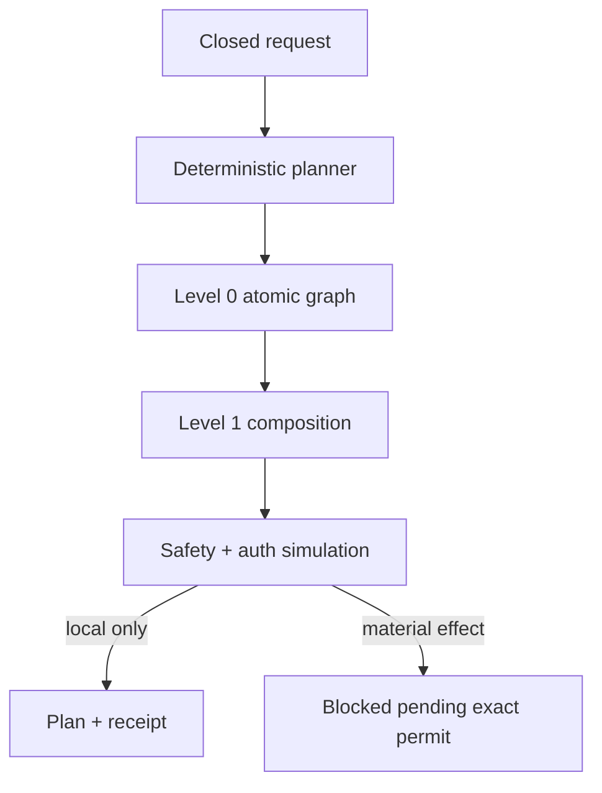
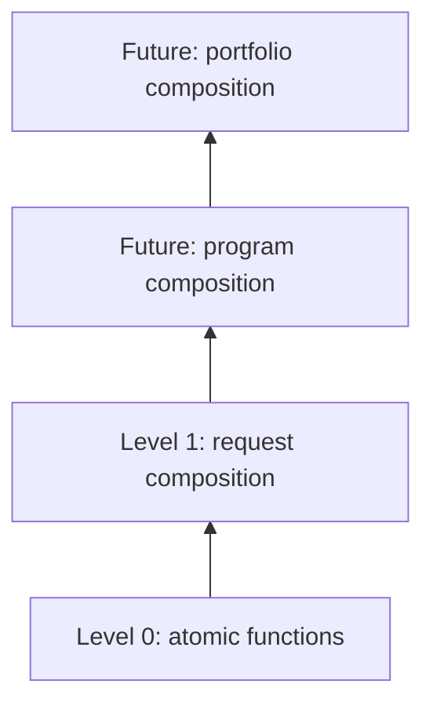
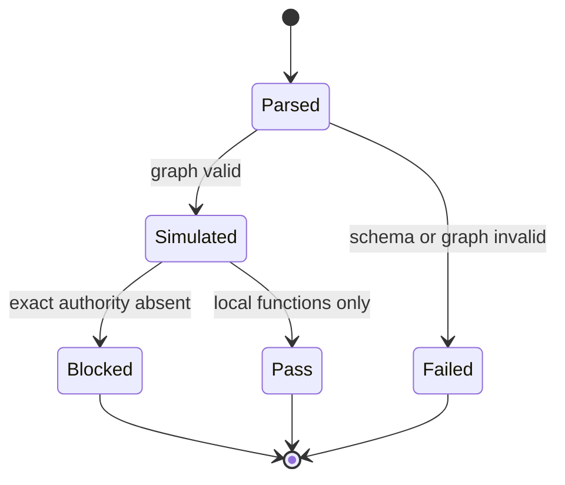

# AIGC Alpha Plan Orchestrator v1

## Purpose

The Alpha Plan Orchestrator turns an objective into one canonical, deterministic, machine-readable action graph and a concise human summary. It plans and simulates; it does not silently turn narrative approval into credentials, spend authority, deployment authority, or permission to contact third parties.

## Canonical contract

Each atomic node carries exact parameters, expected outputs, preconditions, postconditions, a deterministic idempotency token, authorization requirements, retry behavior, error handling, observability hooks, estimated cost and rollback or compensation steps. Level 0 contains only atomic functions. Higher levels contain only compositions of lower-level node identifiers.

| Property | v1 rule | Why it matters |
|---|---|---|
| Determinism | Fixed seed, canonical JSON and content-derived identifiers | The same request produces the same graph and receipt |
| Closed input | Unknown and authority-shaped fields are rejected | Prompt text cannot mint privileges |
| Idempotence | Token derives from request, operation and parameters | Safe replay detection |
| Consequence ceiling | External, financial, contractual and deployment functions block | Planning cannot become an uncontrolled side effect |
| Retry | Consequential calls never auto-retry; reconcile first | Avoid duplicate orders, messages or payments |
| Memory | SQLite adapter requires consent references for durable facts | Persistence is explicit and auditable |
| Meta-learning | Bounded suggestions run in shadow mode only | Experience cannot silently rewrite policy |

## Alpha levels

The present implementation emits levels 0 and 1. Higher levels are reserved until their schemas, invariants and evaluation evidence exist; this prevents a mythic label from being mistaken for an implemented capability.

## Runtime state model

`execution_requested=true` means “include an exact executor sequence,” not “execute it.” The read-only MCP tool `aigc_compose_alpha_plan` performs zero provider calls, zero persistence writes, zero meta-policy application and zero external actions.

## Domain profiles

| Profile | Default graph | Effect ceiling |
|---|---|---|
| `GENERAL` | validate → compose → verify | Local plan |
| `MULTIMODAL_ECOSYSTEM` | architecture, agents, data, runtime, governance, DevOps, evaluation, UX, legal | Blueprint only |
| `PROCUREMENT_ACCELERATION` | discovery → sourcing → negotiation → contracting → fulfillment → finance → evaluation | Synthetic local plan |

The multimodal profile models the nine dimensions in the source blueprint. It does not claim that Whisper, YOLO, a 7B LLM, Kafka, Kubernetes, Argo, OPA, or any cloud resources are installed or paid for.

## Memory and meta-policy

The SQLite memory adapter stores durable facts only when a `consent://` artifact reference is supplied, honors TTL, rejects credential-like content and emits deterministic hashes. The meta-policy component can propose clipped weight changes of at most `0.01`; every proposal remains `applied=false`, requires shadow evaluation and requires human review. A stable fallback policy is always available.

## Integration surface

- Python: `src/alpha_plan/`
- JSON Schema: `schemas/aigc_alpha_plan.schema.json`
- Policy: `config/aigc_alpha_plan_policy.v1.json`
- Domain profiles: `config/aigc_alpha_domain_profiles.v1.json`
- MCP: `aigc_compose_alpha_plan`
- Plugin bridge: `aigc_compose_alpha_plan`
- Tests: `tests/test_alpha_plan.py` plus MCP and bridge contract tests

## Explicit non-claims

This subsystem is not an autonomous legal person, bank account holder, procurement officer, deployment principal, patent broker, investment adviser, or unlimited self-modifying intelligence. It does not “take over a server.” Those activities require accountable human or institutional actors, current law and policy checks, and exact authenticated authority outside the prompt.
