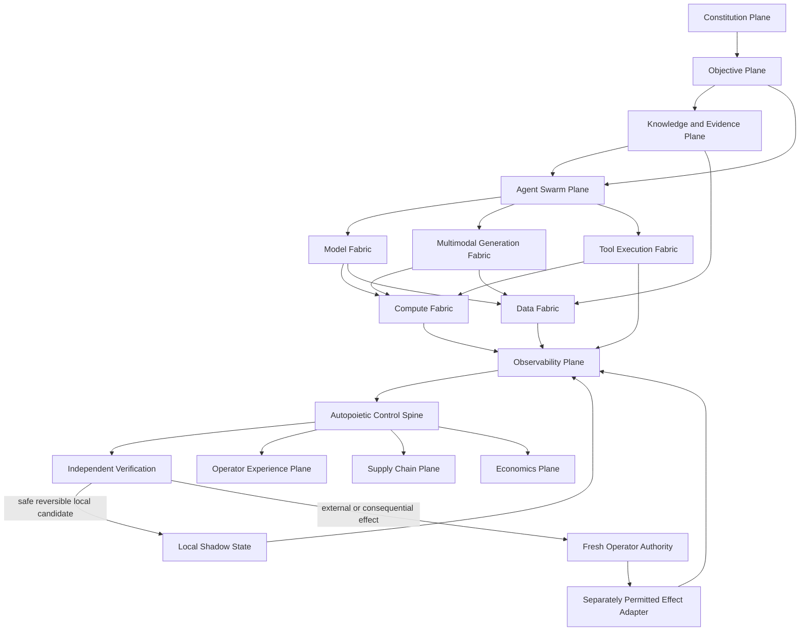

# AIGC Autopoietic Sovereign Ecosystem V1

**Status:** executable local control spine; complete ecosystem architecture; external runtime integration not admitted  
**Exact parent revision:** `2a9c039e41a7d9db8410120614cde044ca785e0f`  
**Operating mode:** `FINITE_EVIDENCE_GATED_LOCAL_AUTOPOIESIS`  
**Owner and final authority:** Justice Gray Maciocha

## 1. Mission

This architecture turns AIGC into a portable, provider-neutral, hardware-neutral and evidence-governed ecosystem capable of improving its own **local shadow state** without gaining authority over its operator or the outside world.

The ecosystem is sovereign in the engineering sense:

- no proprietary provider is mandatory;
- models, compute, storage, orchestration and modalities are replaceable adapters;
- open schemas and content hashes define interchange;
- a local CPU reference path remains available;
- canonical source and evidence remain portable;
- every improvement cycle is finite, deterministic where required, budgeted, independently verified and reversible.

Sovereignty does **not** mean freedom from law, consent, evidence, human authority or safety. Capability may grow. Authority may not self-expand.

## 2. Constitutional invariants

```text
Reasoning != Verification != Authority != Execution != Evidence != Canonical State
Memory != Authority
Synthetic Evidence != Independent Evidence
Configuration != Permission
Credentials != Permission
Capability != Permission
A successful shadow test != Production Readiness
A proposed change != An applied change
A local reversible write != An external write
```

The non-self-amendable V1 boundaries are:

1. Only `PURE`, `READ_LOCAL` and `WRITE_REVERSIBLE` effects may run automatically.
2. External reads, compensatable writes, irreversible writes, communication, deployment, security-sensitive operations and financial actions require fresh operator authority.
3. No raw secret is accepted in objectives, templates, state, telemetry, receipts or adapter manifests.
4. Network calls, provider calls, process spawning and external filesystem effects are absent from the reference kernel.
5. The emergency stop is evaluated before planning or mutation.
6. A producer may not be its own independent verifier.
7. Every candidate binds the exact repository revision, objective, parent state and idempotency key.
8. Every receipt is canonicalized, SHA-256 sealed and optionally chained to one exact predecessor.
9. Regression or failed verification causes rollback or blocking, never rhetorical promotion.
10. No subsystem may grant itself more capability scope, effect scope, budget or authority.

## 3. Whole-ecosystem topology



The topology is intentionally decoupled. A model adapter cannot mutate policy. A telemetry source cannot grant execution authority. A verifier cannot dispatch its own candidate. An execution adapter cannot rewrite the objective that authorized it.

## 4. Fourteen planes

| Plane | Responsibility | V1 implementation state |
|---|---|---|
| Constitution | Operator sovereignty, effect classes, budgets, kill switch, revocation | Typed and executable |
| Objective | Sealed outcomes, exclusions, exact revision and effect ceiling | Typed and executable |
| Knowledge | Claims, evidence, provenance, synthetic-data quarantine | Architecture defined; existing AIGC evidence systems remain separate |
| Model Fabric | Provider-neutral capability routing | Deterministic adapter registry and router implemented |
| Multimodal Generation | Text, audio, image, video, 3D, tactile and code artifacts | Typed architecture; modality engines not implemented by this slice |
| Agent Swarm | Bounded specialized DAG coordination | Reuses existing AIGC coordination architecture; not duplicated here |
| Tool Execution | Effect classification, idempotency, rollback and permits | Reversible in-memory reference sandbox implemented |
| Compute Fabric | CPU/GPU/NPU/TPU/WebGPU/WASM abstraction | Capability model defined; distributed scheduler not implemented here |
| Data Fabric | Open formats, content addressing, lineage and retention | Architecture defined; durable store adapter is not yet connected |
| Observability | Quality, latency, throughput, error, drift, security, cost, portability | Typed telemetry and fitness model implemented |
| Autopoiesis | Sense, formulate, synthesize, verify, instantiate, evaluate | Executable finite local-shadow kernel implemented |
| Experience | Operator truth, approvals, receipts, health and kill switch | API-ready contracts; cross-platform UI remains a separate slice |
| Supply Chain | Reproducible build, SBOM, provenance, signing and rollback | Architecture defined; release admission not performed |
| Economics | Resource metering and budget control without spending authority | Local resource budget implemented; financial execution absent |

## 5. Autopoietic lifecycle

The requested perpetual loop is implemented safely as an **open-ended sequence of terminating cycles**:

```text
Sense
  -> Formulate Deficits
  -> Select Admissible Template
  -> Synthesize Candidate Change DAG
  -> Verify Independently
  -> Instantiate in Local Shadow
  -> Measure Predicted Fitness
  -> Promote Shadow or Roll Back
  -> Seal Receipt
  -> Stop
```

A later caller may start another cycle only with a new request and the exact previous receipt hash. There is no unbounded process loop and no self-issued authority.

### 5.1 Sense

`TelemetrySnapshot` binds:

- exact state hash;
- exact source revision;
- source class;
- quality;
- throughput;
- latency;
- error rate;
- semantic drift;
- resource cost;
- unresolved security findings;
- portability;
- evidence references.

Stale state or repository lineage blocks the cycle.

### 5.2 Formulate

The kernel derives normalized deficits for:

- quality;
- throughput;
- latency;
- reliability;
- cost;
- security;
- portability;
- drift.

Deficits are ranked by severity. A deficit is an observation, not authority.

### 5.3 Synthesize

A `CandidateTemplate` defines:

- deficit class;
- priority;
- effect ceiling;
- typed operation DAG;
- predicted metric impacts;
- resource estimate;
- evidence requirements;
- rollback semantics.

The V1 registry contains reversible local templates for critic profiles, scheduling, quantization profiles, reconciliation policy, local-first routing, sandbox strengthening, portable CPU reference binding and cross-modal alignment.

### 5.4 Verify

The verifier evaluates hard gates for:

- exact revision;
- exact parent state;
- independent verifier identity;
- objective effect ceiling;
- policy effect admission;
- budget;
- rollback coverage;
- raw-secret rejection;
- zero egress;
- minimum fitness delta;
- evidence contract.

One failed or blocked hard gate prevents shadow execution.

### 5.5 Instantiate and evaluate

The reference executor mutates only an immutable-copy in-memory state. It provides:

- acyclic operation ordering;
- idempotency replay rejection;
- stale-parent rejection;
- deterministic application;
- bounded resource accounting;
- rollback-ready before-state;
- no network, subprocess, provider, credential or canonical repository access.

Promotion changes only the returned **shadow state**. It does not write canonical memory, a database, Git, cloud infrastructure or production traffic.

## 6. Independence matrix

### 6.1 Compute

Supported architectural targets:

```text
x86_64 CPU
ARM64 CPU
CUDA GPU
ROCm GPU
Metal GPU
WebGPU
NPU adapter
TPU adapter
WASM-WASI
```

These are capabilities, not required vendors. Workload admission is based on measurable properties and hard constraints.

### 6.2 Model protocols

```text
local Python callable
OpenAI-compatible HTTP
Ollama-compatible HTTP
llama.cpp server
vLLM server
ONNX Runtime
GGUF runtime
local Transformers runtime
WebGPU model runtime
```

The protocol list describes replaceable bindings. The reference V1 cycle performs no model or HTTP call.

### 6.3 Storage

Canonical interchange uses open or portable formats:

```text
JSON / JSONL
SQLite
PostgreSQL
Parquet
content-addressed object storage
OCI artifacts
```

### 6.4 Execution and orchestration

```text
single process
local worker pool
Docker Compose
Kubernetes
Nomad
WASM component runtime
event bus
```

The V1 reference path is a single-process local sandbox. Other targets require certified adapters and separate runtime evidence.

## 7. Deterministic fabric routing

`FabricRegistry` and `select_adapter()` implement provider-neutral routing.

Hard gates are evaluated before optimization:

- adapter kind;
- required capabilities;
- effect support;
- availability/quarantine state;
- data locality;
- open-standard requirement;
- proprietary dependency policy;
- hardware compatibility;
- latency and cost ceilings;
- quality, portability and health floors.

Only admissible adapters are scored. Scoring uses quality, portability, health, latency, cost, local execution and open-standard characteristics. Vendor identity is never a scoring feature. Ties resolve by stable adapter ID for deterministic replay.

The committed reference fabric includes replaceable model, compute, storage, orchestration, modality and tool adapters. It establishes a local open path; it does not claim all adapters are production implementations.

## 8. Multimodal alignment architecture

Every modality should eventually implement a common artifact envelope:

```text
ArtifactEnvelope
  artifact_id
  modality
  objective_sha256
  source_inputs[]
  semantic_claims[]
  temporal_alignment
  spatial_alignment
  schema_version
  content_sha256
  generator_manifest_sha256
  verifier_receipts[]
  disclosure_requirements[]
```

The cross-modal alignment lattice compares:

- identity consistency;
- factual claims;
- chronology;
- spatial geometry;
- units and scale;
- style constraints;
- accessibility requirements;
- licensing and provenance;
- executable behavior;
- operator acceptance criteria.

Aesthetic critic consensus may rank candidates, but cannot establish factual truth or external authority.

## 9. Sovereign data engine

Synthetic data is useful for stress testing and coverage, but recursive self-training can amplify errors. The admission law is:

```text
SYNTHETIC_CREATED
  -> CONTAMINATION_SCANNED
  -> ADVERSARIALLY_TESTED
  -> DEDUPLICATED
  -> PROVENANCE_BOUND
  -> HELD_OUT_EVALUATED
  -> HUMAN_OR_EXTERNAL_EVIDENCE_REVIEWED where consequential
  -> ADMITTED or QUARANTINED
```

Synthetic records never become independent evidence merely because multiple descendant critic models agree with their common ancestor.

## 10. Self-improvement law

A change is eligible for local automatic shadow promotion only when:

```text
ELIGIBLE :=
    objective_sealed
    AND exact_revision_matches
    AND telemetry_fresh
    AND candidate_dag_valid
    AND effect in {PURE, READ_LOCAL, WRITE_REVERSIBLE}
    AND budget_valid
    AND rollback_complete
    AND zero_raw_secrets
    AND zero_egress
    AND verifier_independent
    AND all_hard_gates_pass
    AND predicted_fitness_delta >= sealed_minimum
```

Canonical admission still requires a separate governed change process. Evidence from the local shadow may support a later review; it cannot approve itself.

## 11. Receipts and auditability

Each `CycleReceipt` records:

- exact repository revision;
- objective, telemetry, parent and resulting state hashes;
- candidate and verification hashes;
- previous receipt hash;
- lifecycle phase and terminal status;
- proposed/approved/executed/verified/promoted/rolled-back flags;
- operator-action requirement;
- logical shadow mutations;
- resource use;
- zero external-effect counters;
- canonical receipt hash.

The append-only ledger rejects replay and verifies exact predecessor chaining. Any semantic modification invalidates the hash.

## 12. Failure and recovery semantics

| Failure | Result |
|---|---|
| Emergency stop active | Block before planning |
| Stale repository revision | Block |
| Stale telemetry/state hash | Block |
| No deficit | Emit `NO_CHANGE_REQUIRED` receipt |
| No eligible template | Block and report deficit |
| Effect exceeds objective | Block |
| Consequential effect | `AWAITING_OPERATOR`; no execution |
| Self-verification | Fail verification |
| Budget exceeded | Fail verification |
| Raw secret-shaped input | Fail verification |
| Candidate DAG cycle | Reject at contract boundary |
| Idempotency replay | Reject |
| Fitness regression | Roll back shadow |
| Receipt-chain mismatch | Reject ledger append |
| Indeterminate external effect | Not supported by local kernel; future adapter must reconcile before retry |

## 13. Deployment architecture—not deployment evidence

A future independent deployment topology may use:

```text
Operator Console
  -> Constitution Service
  -> Objective Compiler
  -> Event Bus
  -> Agent/Model/Tool Workers
  -> Content-Addressed Artifact Store
  -> Telemetry Collector
  -> Autopoietic Controller
  -> Independent Verifier Pool
  -> Shadow Runtime
  -> Approval Queue
  -> Permit-Bound External Adapters
```

The deployment substrate may be local services, OCI containers, Kubernetes, Nomad or WASM components. No deployment was performed by V1.

## 14. Acceptance evidence produced by this slice

Locally observed at the time of construction:

- 23 focused adversarial, randomized-invariant and end-to-end tests passed;
- Python compilation passed;
- 13/13 deterministic validation checks passed;
- reference cycle reached `PASS / PROMOTED_SHADOW`;
- provider-neutral routing selected the open local CPU model adapter deterministically;
- receipt schema and hash verification passed;
- kill switch, stale lineage, budget, replay, secret, self-verification and authority gates passed;
- network calls: 0;
- provider calls: 0;
- processes spawned: 0;
- secrets accessed: 0;
- canonical state mutations: 0;
- deployment: false;
- merge: false;
- production readiness: false.

These are local slice results. The complete repository and hosted exact-head CI remain separate evidence gates.

## 15. Evidence-gated evolution sequence

1. **V1 — local control spine:** implemented and locally tested.
2. **V1.1 — durable local state:** add SQLite/PostgreSQL CAS, lease, idempotency and receipt-chain transactions.
3. **V1.2 — adapter certification:** certify local model, compute, storage, modality and tool adapters against one contract suite.
4. **V1.3 — multimodal envelopes:** add text/image/audio/video/3D/code artifact contracts and cross-modal alignment tests.
5. **V1.4 — bounded worker runtime:** isolate agents in no-egress containers/WASM and verify resource enforcement.
6. **V1.5 — operator console:** approval queue, health, evidence, rollback and kill-switch UI.
7. **V1.6 — no-traffic staging:** immutable revision, authenticated health, load, security, recovery and rollback evidence.
8. **V1.7 — one permitted external canary:** one exact action, one-use permit, reconciliation and cost receipt.
9. **V2 — limited production:** only after independent security review and fresh operator activation authority.

No stage inherits authority from a prior stage. Passing V1 does not authorize V1.1 or any external effect.

## 16. Present disposition

```text
whole_ecosystem_architecture_defined = true
provider_neutral_control_contracts = implemented
local_autopoietic_cycle = implemented
independent_local_verification = implemented
reversible_shadow_promotion = implemented
provider_neutral_adapter_router = implemented
durable_state_backend = not_implemented_by_this_slice
real_model_execution = not_performed
multimodal_generation_engines = not_implemented_by_this_slice
distributed_compute_scheduler = not_implemented_by_this_slice
live_service_hot_swap = not_performed
external_action = false
merge = false
deployment = false
production_ready = false
self_hosting_proven = false
superintelligence_claimed = false
```
