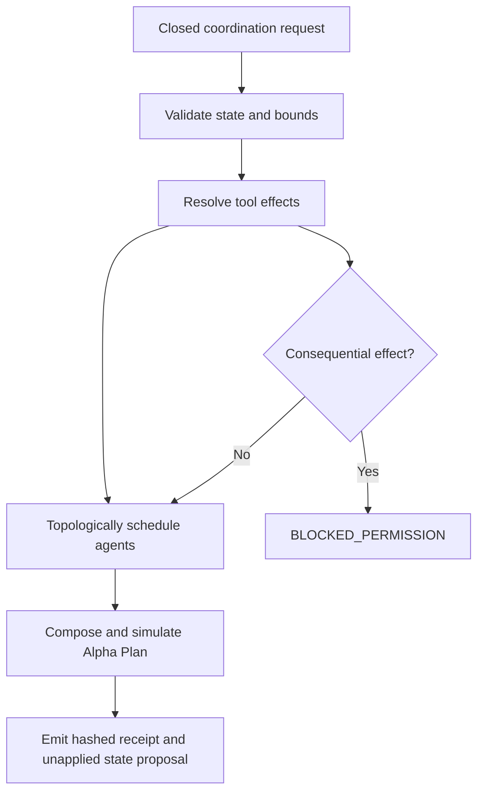

# AIGC Coordination Engineering Endpoint V1

## Definition

`POST /v1/coordination/engineer` is AIGC's deterministic engineering surface for
state, bounded iteration, tool-function admission, and multi-agent coordination.
It turns one closed request into a versioned coordination receipt and an embedded
Alpha Plan. It does not run the plan, call a provider, spawn an agent process,
dispatch a tool, persist memory, mutate state, or grant authority.

The endpoint exists to make four previously distributed concerns explicit in one
contract:

| Dimension | Request definition | Engineered output | Hard boundary |
|---|---|---|---|
| State | ID, revision, parent hash, artifact references, bounded values | Canonical state hash and a proposed, unapplied next revision | Input values are hashed but not echoed; no write occurs |
| Iteration | Current/max iteration, progress delta, no-progress limit, stop conditions | Next-iteration decision and exact total tool-call ceiling | At most 12 iterations and 512 planned calls |
| Tooling | Function, purpose, parameters, output types, effect, data class, budgets, rollback | Deterministic Alpha nodes and permission dispositions | Secrets and caller-shaped authority are rejected; no dispatch occurs |
| Multi-agent coordination | Agent role, mandate, capabilities, tool assignments, dependencies, output and verifier | Topological execution waves, parallel-cap partitions, dependency propagation, and per-agent dispositions | Unknown references and cycles fail closed; no process is spawned |

## Flow



## Public contract

The request and response schemas are generated from frozen Pydantic contracts:

- `schemas/aigc_coordination_engineering_request.schema.json`
- `schemas/aigc_coordination_engineering_receipt.schema.json`

Reference input:

- `config/aigc_coordination_example.v1.json`

Run locally:

```bash
.venv/bin/python -m uvicorn src.webapp.regenexcalibur_api:app \
  --host 127.0.0.1 --port 8000
curl -sS -X POST http://127.0.0.1:8000/v1/coordination/engineer \
  -H 'content-type: application/json' \
  --data @config/aigc_coordination_example.v1.json
```

## Engineered function graph

| Function | Inputs | Output | Dependency | Effect |
|---|---|---|---|---|
| `coordination.state.validate` | State ID, revision, hashes, artifact refs | State-validation receipt and canonical hash | Request contract | Pure |
| Each requested tool function | Exact bounded parameters and call budget | Typed declared output | Validated state | Request-declared and policy-classified |
| `coordination.agent.coordinate` | Agent role, mandate, capability/tool/dependency map | Candidate and independent verification receipt | State, assigned tools, predecessor agents | Pure planning |
| `coordination.iteration.evaluate` | Progress/iteration limits, acceptance criteria, stop conditions | Iteration decision and progress receipt | All agent nodes | Pure |
| `coordination.receipt.emit` | Request, state hash, Alpha Plan receipt | Coordination receipt | Iteration decision | Pure |

Every Alpha node includes exact parameters, expected outputs, preconditions,
postconditions, an idempotency token, authorization requirements, retry policy,
error handling, observability hooks, estimated cost, and disposition.

## State semantics

The endpoint computes:

1. `input_sha256` over the normalized closed request;
2. `state_sha256` over the submitted state envelope;
3. an Alpha Plan receipt hash over the deterministic function graph;
4. `candidate_state_sha256` over the prior hash, proposed revision, request ID,
   and Alpha Plan receipt.

The candidate transition is always `PROPOSED_NOT_APPLIED`. A separate governed
executor and a confirmed execution receipt are required before the canonical
state reducer may admit a real transition.

## Iteration semantics

An endpoint call engineers one pass; it never starts an autonomous loop. The
response declares the next permitted iteration, total plan ceiling, and stop
conditions. The last available pass stops with
`ITERATION_BUDGET_EXHAUSTED_AFTER_CURRENT_PASS`. This makes recursion finite,
auditable, and caller-controlled.

## Tool and authority semantics

`PURE`, `READ_LOCAL`, credential-free public reads, and reversible local-sandbox
functions are simulation-ready. Consequential functions are still represented
exactly in the Alpha Plan but receive `BLOCKED_PERMISSION`; an indeterminate
prior outcome receives `RECONCILIATION_REQUIRED` and cannot be blindly retried.
An execution request returns `ENDPOINT_PLAN_ONLY` and does
not change the effect counters. Authority-like keys, credential-like values,
unknown tool assignments, unknown agent dependencies, and cyclic graphs return
HTTP 422.

## Terminal truth

`PASS` means the local plan is structurally valid and ready for a later
simulation step. `BLOCKED` means a declared effect needs authority, execution was
requested from this plan-only surface, or the bounded iteration window is spent.
Neither status means production readiness.

Every successful HTTP response keeps these claims fixed:

| Claim | Value |
|---|---:|
| `production_ready` | `false` |
| `authority_granted` | `false` |
| `provider_calls_performed` | `0` |
| `tool_dispatches_performed` | `0` |
| `processes_spawned` | `0` |
| `memory_writes_performed` | `0` |
| `external_actions_performed` | `0` |

## Validation evidence

```bash
.venv/bin/python scripts/generate_coordination_contracts.py
.venv/bin/python scripts/run_coordination_endpoint_acceptance.py
.venv/bin/python -m pytest -q tests/test_coordination_engine.py \
  tests/test_regenexcalibur_api.py tests/test_alpha_plan.py
```

The acceptance runner verifies the happy path twice, deterministic equality,
OpenAPI closure, hidden state values, DAG waves, embedded Alpha Plan, execution
blocking, secret rejection, cycle rejection, zero egress, and zero authority.
Its committed local receipt is
`reports/artifacts/aigc_coordination_endpoint_local_validation.json`.
