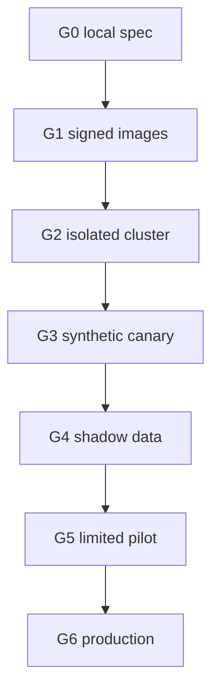

# Procurement sandbox deployment blueprint

## State

`DESIGN_ONLY / DEPLOYMENT_NOT_AUTHORIZED / ZERO_REPLICAS / ZERO_EGRESS`

## Promotion ladder

| Gate | Required evidence | Current state |
|---|---|---|
| G0 Local specification | Schema, policy and deterministic fixture tests | Implemented locally |
| G1 Container supply chain | Built images, SBOM, signatures, provenance, vulnerability review | Blocked |
| G2 Isolated cluster | Approved account/region, workload identity, secrets broker, quotas | Blocked |
| G3 Synthetic canary | Observability, incident drill, rollback and reconciliation | Blocked |
| G4 Shadow real-data evaluation | DPA, residency, minimization, current authoritative feeds | Blocked |
| G5 Limited external pilot | Exact supplier scope, legal review, operator approvals | Blocked |
| G6 Production | SLO history, independent security/compliance review, budget owner | Blocked |

Every transition requires a new receipt. No earlier gate authorizes a later one. Production deployment additionally requires immutable non-placeholder image digests, namespace quotas, persistent encrypted storage, restore tests, egress allowlists, current vendor terms, alert ownership, on-call coverage and a tested kill switch.

## Minimum observability contract

- Counters: plans, blocked nodes, policy violations, reconciliations.
- Histograms: planning latency, simulated stage latency.
- Gauges: queue depth, active permits, unresolved indeterminate results.
- Traces: request → node → policy decision → local artifact.
- Audit: append-only record of actor, intent, input digest, policy digest, output digest and terminal status.

No savings, delivery, uptime or compliance metric is a result until produced from authorized evidence with provenance.
