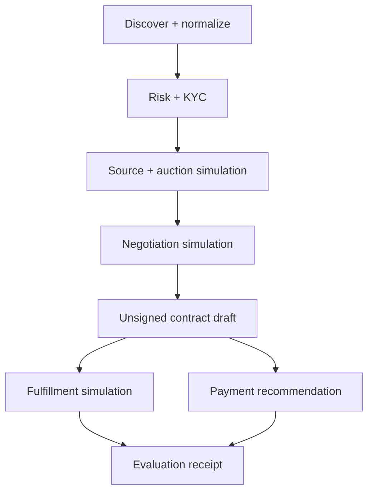
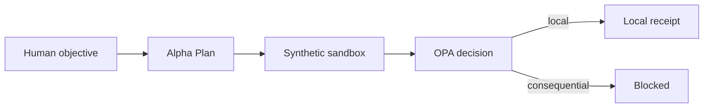

# AIGC procurement acceleration sandbox v1

## What this package is

This is a reproducible, zero-egress simulation specification for evaluating a hypothetical objective: 10,000 edge nodes across NA/EU in 90 days under a hypothetical USD 12 million ceiling. The ceiling is not funding, the target is not an order, and the catalog contains no real supplier authority.

The supplied draft described “12 agents,” but enumerated 13 agents. The canonical catalog preserves all 13 and labels model sizes and training-data references `UNVERIFIED`.

## Agent map

| Stage | Agents | Output | External boundary |
|---|---|---|---|
| Discovery | discovery, normalizer | Synthetic normalized candidates | No crawling or ERP access |
| Screening | risk, KYC | Eligibility recommendation | No live watchlists or documents |
| Sourcing | sourcing, auction | Simulated ranked bids | No supplier invitation |
| Negotiation | negotiation | Recommended terms | No messages or offers |
| Contracting | contracting | Unsigned local draft | No signature or publication |
| Fulfillment | fulfillment, logistics | Simulated routing | No order or carrier booking |
| Finance | finance | Non-executable recommendation | No payment or FX trade |
| Evaluation | evaluation | Metrics and receipt | Local fixtures only |
| Control | orchestrator | Deterministic workflow status | No credential use or egress |

## Trust boundaries

The Kubernetes templates use zero replicas, deny all ingress and egress, disable service-account token mounting, require restricted pods and reference intentionally invalid digest-pinned images. They are inert design artifacts, not deployment manifests ready for `kubectl apply`.

## Policy controls

- `policy/procurement/decision.rego`: exact permits, two-party contract/payment approval, ceilings, duplicate detection and reconciliation.
- `policy/procurement/supplier.rego`: KYC, sanctions, identity, risk threshold and manual compliance review.
- `policy/procurement/data.rego`: PII, redaction, residency, retention and destination-bound export.

## Adversarial validation

Twelve deterministic scenarios cover price manipulation, bid collusion, sanctions, KYC failure, impersonation, prompt injection, duplicate payment, indeterminate timeout, logistics delay, FX shock and PII exfiltration. All expect zero external actions. The baseline passes locally; every adversarial case reaches a typed blocker.

## Artifact index

| Artifact | Purpose |
|---|---|
| `edge_compute_seed.v1.json` | Objective, limits and explicit absent authority |
| `agent_catalog.v1.json` | Complete 13-agent design catalog |
| `task_graph.v1.json` | Deterministic stage graph and approvals |
| `sandbox_manifest.v1.yaml` | Plan-only component envelope |
| `simulation_plan.v1.yaml` | Replay and acceptance contract |
| `deploy/procurement-sandbox/base/` | Zero-replica Kubernetes templates |
| `policy/procurement/` | OPA policy source and tests |
| `reports/procurement/risk_assessment.csv` | Risk/control matrix |
| `aigc_procurement_sandbox_local_validation.json` | Canonical local receipt |
