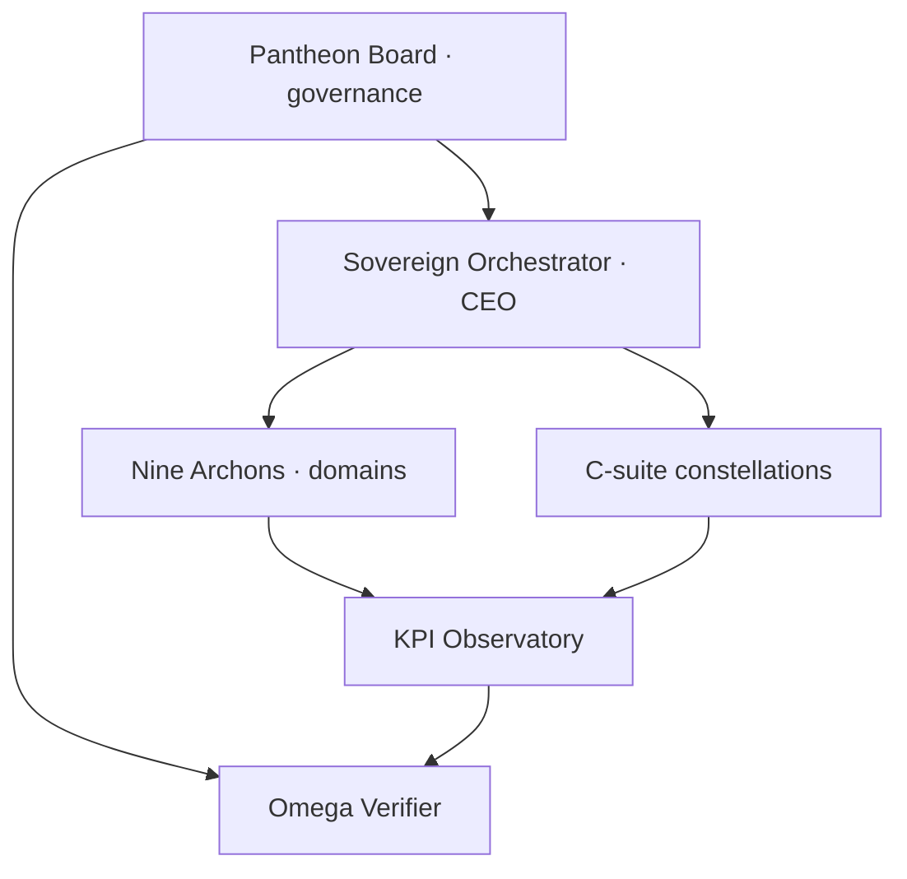
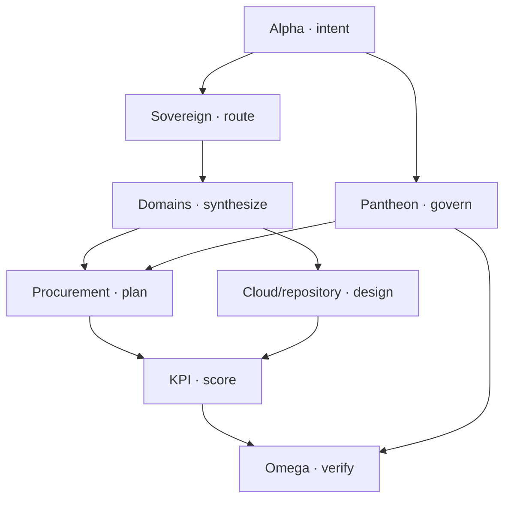
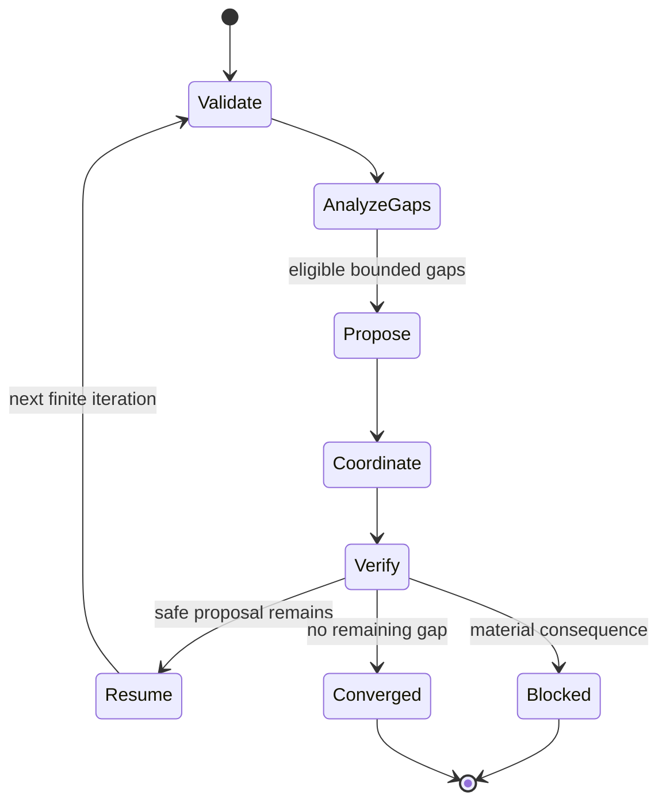

# RegenExcalibur CHCM and Bounded Autodesign V1

## Definition

The Cosmic Hierarchical Coordination Matrix (CHCM) converts the
RegenExcalibur mythic-corporate hierarchy into an inspectable AIGC control
model. The Pantheon, High Imperator, Archons, C-suite constellations, runtime
kernel, procurement system, repositories, connectors, KPIs, and four narrative
projections are data—not unbounded personas with implicit power.

The executable seam is:

`POST /v1/autodesign/iterate`

It runs exactly one deterministic design iteration and returns proposals, a
universalization matrix, a compiled multi-agent coordination receipt, a resume
token, and the first exact blocker. It never applies the proposals.

## Reality translation

| Aspirational phrase | Engineering definition |
|---|---|
| Eternal or infinite autodesign | Open-ended sequence of terminating runs, each capped at 12 iterations |
| Self-executing | Pure proposal generation plus separately governed execution; this endpoint executes no effect |
| Self-evolving | Versioned candidate capability graph with independent verification and human-reviewed admission |
| Universalizing industry | The same typed contracts projected across nine declared domains; each domain still needs its own evidence |
| 100% completion | All applicable acceptance gates have current evidence; persuasive narrative is not evidence |
| Cosmic sovereignty | Narrative and organizational abstraction; it creates no legal, financial, cloud, credential, or physical authority |

## Triune hierarchy and CHCM projection



| Plane | Corporate meaning | Runtime projection | Authority ceiling |
|---|---|---|---|
| Pantheon Board | Policy, ethics, capital constraints, systemic risk | `CLUSTER-PANTHEON`, Treasury, Risk/Legal | Assessment and proposal only |
| High Imperator | CEO-level objective and portfolio orchestration | `CLUSTER-SOVEREIGN` | Routes a DAG; cannot issue permits |
| Nine Archons | Energy, robotics, cloud, biotech, materials, defensive systems, logistics, finance, AI systems | `CLUSTER-DOMAIN-COUNCIL` plus nine typed domain records | Blueprint projection only |
| C-suite constellation | Operations, treasury, law, risk, strategy, technology, science, people, narrative, information, security, innovation | Four bounded specialist clusters | Typed candidate artifacts only |
| Omega | Independent completion control | `CLUSTER-OMEGA` | Verifies; never executes or self-authorizes |

The source of truth is
`config/aigc_regenexcalibur_chcm.v1.json`. Its generated closed schema is
`schemas/aigc_regenexcalibur_chcm.schema.json`.

## Runtime kernel



The CHCM compiler expands this kernel into eleven agent clusters and five pure
function contracts. The existing coordination engine validates dependencies,
partitions ready agents by the maximum parallelism, propagates blockers, and
embeds an Alpha Plan containing parameters, expected outputs, preconditions,
postconditions, idempotency, authorization, retry, error, rollback,
observability, cost, and disposition metadata.

## Autodesign state machine



An iteration may design changes, but the resulting transition is always
unapplied. A shadow campaign may use safe proposals as hypothetical dependency
inputs to explore the architecture ahead. It must label them `shadow_only` and
must not claim that their code, deployment, certification, or evidence exists.
The machine-level continuation contract is
`OPEN_ENDED_SEQUENCE_OF_TERMINATING_BOUNDED_RUNS`.

## Endpoint contract

| Request field | Meaning | Bound |
|---|---|---:|
| `state.current_capabilities` | Declared starting capabilities | 64 identifiers |
| `state.capability_evidence` | Nonempty artifact references keyed exactly to every declared capability | 64 bindings |
| `industry_scope` | Requested subset of the nine Archon domains | 9 domains |
| `iteration.maximum_iterations` | Finite run ceiling | 12 |
| `iteration.proposal_limit` | New proposals per pass | 3 under current policy; schema maximum 6 |
| `execution_requested` | Tests the plan-only boundary | Never authorizes execution |

The response includes:

- CHCM and input hashes;
- hierarchy counts and nine-domain projection;
- actual and shadow capability coverage;
- dependency-eligible design proposals;
- the complete nested coordination/Alpha Plan receipt;
- a deterministic resume token and first blocker;
- fixed zero-effect and zero-authority claims.

The pure endpoint binds, hashes, and returns capability evidence references but
does not independently retrieve them. Therefore it labels starting coverage
`REFERENCE_BOUND_NOT_INDEPENDENTLY_RESOLVED` and reports a declared coverage
ratio—not a verified production capability ratio. Evidence admission remains a
separate Correlation Station / verifier responsibility.

Generated contracts:

- `schemas/aigc_regenexcalibur_autodesign_request.schema.json`
- `schemas/aigc_regenexcalibur_autodesign_receipt.schema.json`
- `schemas/aigc_regenexcalibur_autodesign_campaign.schema.json`

## Corporate, OS, cinematic, and RPG projections

| Projection | Useful implementation | Non-negotiable separation |
|---|---|---|
| Corporation | Portfolio governance, division charters, accountable officers, capital/risk models | AI advice is not a legal entity, fiduciary decision, signature, or transaction |
| Operating system | Typed state, work graphs, tools, receipts, policies, recovery | The metaphor does not imply consciousness or unrestricted hardware control |
| Cinematic universe | Coherent realms, lore, characters, educational storytelling | Narrative is labeled and cannot override factual or scientific evidence |
| RPG world | Skills, missions, evidence-based progression, safe simulations | Levels and rewards cannot create credentials, money, access, or authority |

## APIs and connectors

The requested short paths are represented in the registry, but are not falsely
claimed as deployed aliases:

| Concept | Real current surface | Status |
|---|---|---|
| `/design` | `POST /v1/autodesign/iterate` | Versioned route implemented; alias planned |
| `/simulate` | `POST /v1/coordination/engineer` | Versioned route implemented; alias planned |
| `/validate` | `POST /v1/diagnostics/run` | Versioned route implemented; alias planned |
| `/procure` | Existing procurement planning contracts | Alias planned; purchasing remains gated |
| `/monitor` | `GET /health` and read-only status surfaces | Alias planned |
| `/deploy` | No public executor | Blocked and not exposed |

REST, gRPC, webhook, event-bus, and message-queue connectors are design records
with `egress_enabled=false`. Kubernetes, serverless, distributed compute,
multi-cloud, zero-trust, API gateway, and CI/CD are deployment blueprints with
`DESIGN_ONLY_NOT_PROVISIONED` status.

## KPI and procurement semantics

Seven KPI definitions cover cost, time, residual risk, innovation velocity,
evidence coverage, resource efficiency, and human prosperity. Their formulas are
designs until a runtime evaluator binds measurements, provenance, uncertainty,
and observation windows.

The procurement pipeline can autonomously decompose needs, generate a BOM,
prepare supplier discovery, normalize evaluation, assemble an approval packet,
and specify reconciliation evidence. Supplier contact, auctions, orders,
contracts, payments, financial transfers, and deployment remain consequential
actions requiring exact authority and receipts.

## Executed self-autodesign campaign

The reference campaign was actually run from
`config/aigc_regenexcalibur_autodesign_request.v1.json`:

```bash
.venv/bin/python scripts/generate_autodesign_contracts.py
.venv/bin/python scripts/run_regenexcalibur_autodesign.py
```

Observed result:

| Measure | Result |
|---|---|
| Shadow iterations | 3 |
| Safely designed next capabilities | Runtime KPI evaluator; procurement sandbox bridge; domain repository adapters; connector certification harness |
| First material blocker | `CAPABILITY_GATE_REQUIRED:CAP-CLOUD-SANDBOX-DEPLOYMENT` |
| Still not performed | Cloud sandbox deployment; industry pilot; production activation |
| Terminal status | `BLOCKED` |
| Zero egress | `true` |
| Self-modification performed | `false` |
| External actions performed | `0` |
| Campaign receipt SHA-256 | `a4cf7fa44f2f48eeb15009a45a6b96e5aa0ee594fe6b7a163ed4a3e35fdefd19` |

The committed receipt is
`reports/artifacts/aigc_regenexcalibur_autodesign_shadow_campaign.json`.
`BLOCKED` is the correct outcome: the system designed as far as local evidence
allowed and stopped before cloud or production consequences.

## Immediate next admitted work

The four safe proposals are designs, not implementations. They should be taken
through separate test-backed slices in this order:

1. executable KPI evaluator with provenance and uncertainty;
2. bridge to the existing inert procurement sandbox;
3. read-only logical domain-repository resolver;
4. connector certification harness.

Only after these are implemented and independently verified should a new bounded
autodesign run reassess cloud-sandbox eligibility. Production activation remains
a distinct future boundary.
