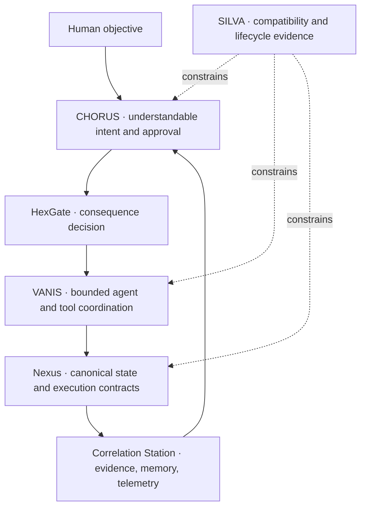
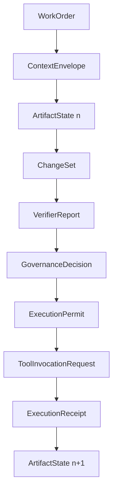
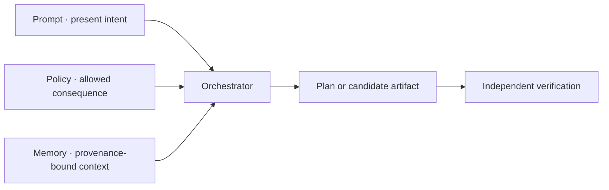
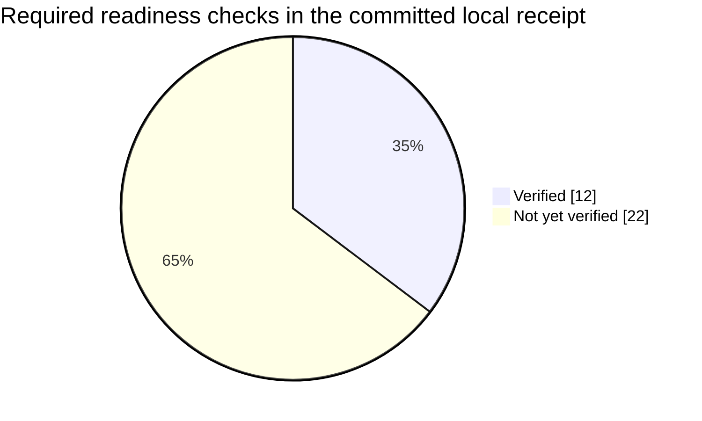
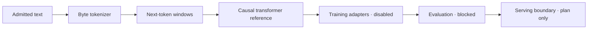
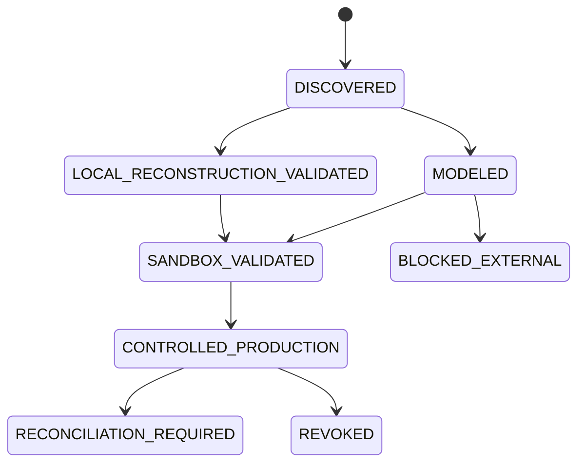

# AIGC System Atlas V1

Status: `CANONICAL NARRATIVE MAP — LOCAL EVIDENCE ONLY`

This atlas translates the AIGC repository into one coherent model. It explains
what the named systems mean, how information moves, which measurements govern
release claims, and where implementation ends and external authority begins.

## 1. What AIGC is

AIGC—Artificial Intelligence Gladiator Coliseum—is a governed AI work operating
system, not a single chatbot and not an unrestricted automation bot. The
“Coliseum” is the evaluation arena: specialized builders, critics, synthesizers,
and verifiers can compete or cooperate, but only verified work can advance toward
execution.

The platform's intended lifecycle is broader than code generation. It is designed
to help a person discover, obtain, learn, perform, verify, and sustain lawful
digitally performable work through one governed interface. Current repository
evidence proves bounded local contracts and tests—not universal employment,
funding, deployment, mobile, provider, payment, or mainnet operation.

### Identity layers

| Name | Meaning | Engineering role |
|---|---|---|
| AIGC | Artificial Intelligence Gladiator Coliseum | Product and repository ecosystem |
| Nexus V1 | Canonical governed runtime | State, verification, authority, tool, memory, evidence, and runtime contracts |
| Omega-X | Apex orchestrator | Coordinates phases and gates; never bypasses them |
| RegenExcalibur OS | Mythic-technical design universe | Generates bounded, typed, human-reviewed system proposals |
| 1JGM | Product watermark | Identity/provenance marker; never an authority credential |
| OMNIPROJECT APEX-∞ | Project reasoning constitution | Ontology, methodology, heuristics, parametrics, actions, and evidence model |
| OMNI-INTEGRATION MAINNET FORGE Ω∞ | Release and integration doctrine | “Mainnet” means real external operations generally; blockchain is a separate optional surface |
| Revenue-Ω | Commercial work architecture | Cost recovery and lawful revenue preparation; no guaranteed income or automatic charging |

The symbols `Ω`, `∞`, “Prime,” and “Forge” describe orchestration ambition and
iterative scope. They do not mean omniscience, literal infinity, unrestricted
authority, guaranteed outcomes, or completed production deployment.

## 2. The architecture has one governed core and many adapters



The core owns governance. Web, MCP, mobile, CLI, provider, website, payment, and
marketplace integrations are adapters. No user interface, model, agent, or
connector may establish a competing global authority system.

## 3. The five integrated systems are complementary, not decorative

| System | Question it answers | Inputs | Outputs | Failure posture |
|---|---|---|---|---|
| SILVA — System Integration and Lifecycle Validation Architecture | Where does this exact revision demonstrably work? | Platform manifests, device/OS matrix, thresholds, fixtures | Compatibility and lifecycle receipts | Block unsupported or unverified cells |
| HexGate — Six-Gate Trust Boundary | May this consequence proceed now? | Identity, authority, privacy, safety, cost, evidence | Admit, block, or reconcile decision | Deny by default |
| VANIS — Verifiable Agent Network Integration Substrate | Which bounded agent/model/tool path should do the work? | Capability manifests, typed contracts, budgets, risk | Provider-neutral plan and receipt-producing handoffs | No direct agent-output-to-execution path |
| Correlation Station — Evidence and Observability Plane | What happened, why, at what cost, and with which lineage? | States, changes, reports, permits, receipts, telemetry | Immutable evidence graph and reconciliation tasks | Evidence never grants authority |
| CHORUS — Coordinated Human-Orchestrated Runtime and User Surface | What must the human understand or decide? | Intent, plan, risk, cost, blockers, evidence | Accessible control surface, approval packet, takeover | Never infer consent for material consequences |

Together they create a closed loop: SILVA proves applicability; CHORUS captures
intent; HexGate classifies consequence; VANIS coordinates capability; Nexus
executes only under an exact permit; Correlation Station preserves empirical
truth; CHORUS returns the result and any required decision.

## 4. The canonical protocol separates proposal from reality



| Object | What it is | What it cannot do |
|---|---|---|
| WorkOrder | Declared objective and acceptance frame | Grant permission by itself |
| ArtifactState | Immutable observed/canonical state | Contain credentials or execution authority |
| ChangeSet | Proposed transition | Claim the external world changed |
| VerifierReport | Read-only evaluation | Modify the candidate or approve execution |
| GovernanceDecision | Promotion decision bound to exact evidence | Carry credentials |
| ExecutionPermit | Scoped, expiring authority descriptor | Authorize beyond exact actor/resource/action/budget bounds |
| ExecutionReceipt | Empirical record of attempted effects | Manufacture authority retroactively |

The central equation is:

```text
Reasoning != Verification != Authority != Execution != Evidence
```

## 5. Prompt, Policy, and Memory are separate planes



- Prompt can request work but cannot rewrite policy.
- Policy can admit or deny capability but cannot fabricate evidence.
- Memory can improve continuity but cannot grant authority.
- Provider/model routing occurs only after consequence classification and remains
  subject to independent verification.

## 6. The system is defined across measurable dimensions

The OMNIPROJECT APEX-∞ configuration contains a machine-readable conceptual
model. Counts are descriptive of the configuration, not proof that every
external capability exists.

| Dimension | Count | Why it exists |
|---|---:|---|
| Ontology entities | 32 | Gives every actor, object, boundary, and evidence type a distinct meaning |
| Relationships | 30 | Makes ownership, dependency, prohibition, and lineage explicit |
| States | 8 | Prevents ambiguous progress claims |
| Transitions | 9 | Defines preconditions, postconditions, verification, and authority |
| Methodologies | 5 | Selects disciplined approaches for architecture, delivery, security, evaluation, and UX |
| Heuristics | 6 | Supplies bounded shortcuts while retaining override evidence |
| Parameters | 9 | Converts safety, quality, cost, and capability claims into measurable controls |
| Actions | 9 | Turns the project model into sequenced work |
| Decisions | 4 | Records consequential design choices and rejected alternatives |
| Risks | 5 | Connects failure modes to mitigations and owners |
| Constraints | 7 | Defines hard boundaries that optimization cannot trade away |
| External blockers | 6 | Records dependencies repository work cannot create |

### Selected methodology stack

| Method | Fit | Primary job | Important limitation |
|---|---:|---|---|
| DDD + C4 | 94% | Separate authority, evidence, memory, connector, and occupation concepts | Architecture alone does not prove runtime correctness |
| DevSecOps + SRE | 93% | Bind build, release, operation, observability, and recovery | Local CI does not prove production health |
| STRIDE + LINDDUN | 96% | Model security and privacy threats across identity and data flows | Must be refreshed after connector changes |
| Stage-Gate + occupation evaluation | 97% | Certify competence one occupation at a time | Does not replace licensure or employer authority |
| Human-centred design + WCAG 2.2 AA | 92% | Make one-interface operation accessible without hiding gates | Simplicity cannot erase consequence boundaries |

## 7. Parametrics turn “best possible” into falsifiable controls

| Symbol | Parameter | Type | Target or governing meaning |
|---|---|---|---|
| `N_unauthorized` | Unauthorized external actions | Guardrail | Exactly 0 per release |
| `N_secret_exposure` | Secret exposure | Guardrail | Exactly 0 confirmed exposures |
| `N_ambiguous_retry` | Retries after ambiguous dispatch | Guardrail | Exactly 0 before reconciliation |
| `C_connector` | Connector certification coverage | Leading | 1.0 for every enabled live operation |
| `C_verify` | Mandatory verification coverage | Leading | 1.0 for every claimed release scope |
| `R_task_success` | Verified occupation task success | Lagging | Employer/evaluator-derived threshold per occupation |
| `R_correction` | Human correction rate | Lagging | Employer-derived threshold paired with severity |
| `B_external` | External action blast radius | Control | One exact account, destination, operation, and mutation per permit |
| `C_task` | Cost per verified successful task | Objective | Minimize in CAD without trading away quality or safety |

These parameters are paired to resist Goodhart's law. For example, cost is
paired with task success and correction rate; apparent zero incidents are paired
with verification and telemetry coverage; certification coverage is paired with
blast-radius controls.

## 8. Readiness is an evidence ratio, not a confidence score



| Readiness field | Value | Interpretation |
|---|---:|---|
| Applicable required checks | 34 | Checks currently required by the registry |
| Verified required checks | 12 | Checks with admitted receipt-bound evidence |
| Verified applicable ratio | 35.2941% | `12 / 34`; not rounded up to a release claim |
| Minimum release ratio | 95% | Necessary but not sufficient; required authorities must also be true |
| Production ready | False | The release gate remains blocked |
| Authority granted | False | Evidence does not create external permission |
| External action performed | False | The readiness evaluator performed no external production action |

“Implemented,” “locally verified,” “hosted,” “certified,” “authorized,” and
“production ready” are different states. A component may exist in source and pass
unit tests while still lacking identity, terms, deployment, traffic, recovery,
or third-party permission evidence.

## 9. Delivery surfaces are deliberately uneven

| Surface | Required for V1 | Source status | Verified receipts | Main missing evidence |
|---|---:|---|---:|---|
| Linux server | Yes | Implemented | 0/4 | Exact-head CI, immutable image, hosted readiness, load/security/recovery |
| Web | Yes | Implemented | 0/5 | Deployment, responsive browser, accessibility, security, recovery |
| ChatGPT MCP | Yes | Implemented | 3/5 | Host validation and hosted exact-head receipt |
| Gemini MCP | No | Implemented | 0/4 | Gemini client and hosted validation |
| iOS | No | Not implemented | 0/5 | Native target, Apple identity/signing/privacy/submission facts |
| Android | No | Not implemented | 0/5 | Android target, Play identity/signing/listing facts |
| Public blockchain mainnet | No | Blocked | 0/6 | Chain, contract, purpose, custody, legal, audit, and spend authority |
| Revenue-Ω | No | Implemented as draft architecture | 0/6 | Nexus admission plus payment/billing authority and receipts |

“Mainnet” in the Forge title means operating against real external systems. A
public blockchain mainnet is a separate, optional adapter and remains blocked.

## 10. The LLM stack is a reference lifecycle, not a trained foundation model



The repository contains configuration/schema validation, a lossless UTF-8 byte
tokenizer, deterministic dataset windows, an optional PyTorch causal transformer,
bounded pretraining/SFT adapters, a DPO objective, a deterministic lifecycle
receipt, and a disabled-by-default FastAPI boundary.

The committed envelope is `0 CAD` and `0 GPU hours`. No real corpus is admitted,
no checkpoint is promoted, no provider call is made, and no production model is
served. The byte tokenizer is not misrepresented as trained BPE; PPO-style RLHF
remains a declared option rather than a completed implementation.

## 11. Occupation and wealth functions expand capability without silently expanding authority

| Portfolio | Count | Current meaning |
|---|---:|---|
| Draft occupation packs | 13 | Scoped work families awaiting employer/evaluator evidence and recertification |
| Wealth actions | 16 | Closed registry spanning research, preparation, tracking, and execution |
| Policy-path actions | 7 | Public zero-cost research or local reversible preparation |
| Approval-gated actions | 9 | Persistence, submission, communication, contracts, spending, transfers, or trades |

The operator may research opportunities, produce local deliverables, draft
applications/outreach, prepare invoices/transactions, and analyze supplied
records. It does not autonomously submit, send, sign, charge, transfer, trade, or
promise income. Ordinary employment placement economics must use lawful,
explicitly agreed structures; worker-wage deductions are not assumed.

## 12. RegenExcalibur names map to bounded mechanisms

| Universe term | Concrete meaning |
|---|---|
| Prime Kernel | Deterministic orchestration and invariant enforcement |
| Agent Forge | Fixed typed role descriptors; not uncontrolled background agents |
| Design Crucible | Architecture and ontology proposal generation |
| Engineering Loom | Module, API, schema, and acceptance-contract generation |
| Pipeline Serpent | CI, security, observability, rollback, and recovery gates |
| LIFE Beacon | Human-safety, ecological, factual, privacy, and authority constraints |
| Evolution Spire | Bounded proposal/patch recursion with human review |
| Universe Gate | Portable plan-only interface with zero-egress receipts |

“Self-designing,” “self-engineering,” and “self-evolving” mean the system can
generate reviewable artifacts and patches. They do not mean silent self-modifying
code, independent legal agency, or autonomous acquisition of credentials,
infrastructure, money, users, or authority.

## 13. State progression is explicit and reversible where possible



Promotion to controlled production requires current provider/site permission,
identity binding, a one-use action permit, budget/destination binding, and tested
rollback/reconciliation. If an external outcome is indeterminate, automatic retry
is prohibited until read-only reconciliation establishes reality.

## 14. The practical critical path

1. Resolve GitHub Actions billing and obtain a fresh exact-head run that actually
   checks out and tests the branch.
2. Bind the release registry to an exact hosted artifact and immutable image.
3. Validate Linux and web health, readiness, accessibility, security, load,
   recovery, and observability against the immutable artifact.
4. Complete ChatGPT MCP host validation; keep write workflows separately gated.
5. Admit exact provider identities, budgets, secret references, terms, one-use
   canary permits, live receipts, and recovery tests.
6. Select one occupation pack and run employer-owned synthetic evaluation with an
   accepted scoring rubric before expanding breadth.
7. Request public traffic or production activation authority only after evidence
   exists; do not turn missing permission into a documentation claim.

## 15. Source map

| Concern | Canonical source |
|---|---|
| Nexus protocol and authority law | `docs/architecture/AIGC_INTEGRATION_CONTRACT_V1.md` |
| Autonomy/consequence boundary | `docs/architecture/AIGC_INTEGRATION_CONTRACT_V1_AUTONOMY_AMENDMENT_001.md` |
| Five subsystem contracts | `config/aigc_subsystem_contracts.v1.json` and `src/core/nexus/subsystem_contracts.py` |
| Universal surface/connector registry | `config/aigc_universal_integration_registry.v1.json` |
| Readiness evidence | `reports/artifacts/aigc_universal_readiness_local_validation.json` |
| Ontology/methodology/heuristics/parametrics | `config/aigc_omniproj_apex_v2.json` |
| Wealth actions | `config/aigc_wealth_operator_policy.v1.json` |
| Occupation packs | `config/occupation_packs/` |
| LLM lifecycle | `config/aigc_llm_stack.v1.json` and `src/llm_stack/` |
| RegenExcalibur Genesis | `config/regenexcalibur_universe_seed.v1.json` and `src/regenexcalibur/` |
| Portable tool surface | `src/integrations/mcp/server.py` |

The generated data snapshot used to reconcile this atlas is
`reports/artifacts/aigc_system_atlas_local_snapshot.json`. Its scope is local
candidate evidence and it does not replace hosted exact-head CI.
