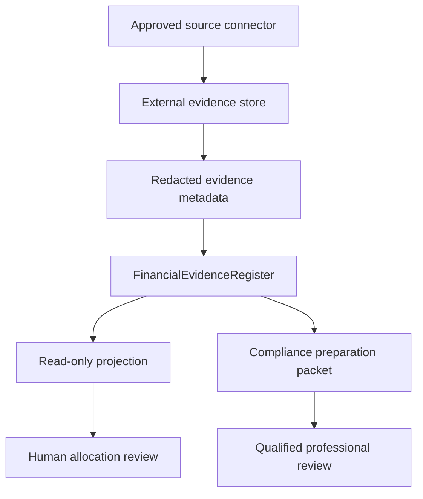

# AIGC Canadian Financial Work Execution Standard v1

Status: `DOCUMENTED / INTERNAL_PREPARATION_ONLY`  
Version: `1.0.0`  
Jurisdictional focus: Canadian federal preparation for Alberta (`CA-AB`) only  
Feature state: disabled by default  
External-action authority: denied

Maturity claim: the schemas and local preparation workflow define an internal contract.
They are not evidence of hosted-CI verification, staging operation, production
deployment, professional acceptance, or government acceptance.

## 1. Purpose

This standard defines a bounded Canadian financial-evidence and compliance-preparation
workflow for an Alberta business context in AIGC. Version 1 can:

- normalize already-authorized, redacted evidence metadata;
- project verified settlement evidence without calling it an accounting ledger;
- keep commercial-obligation signals separate from settled cash;
- prepare unresolved CRA, Alberta, WCB-Alberta, and privacy questions for human review;
- create management-only founder-effort valuation scenarios; and
- emit deterministic, reviewable internal artifacts and receipts.

Version 1 cannot log in to a government or financial account, handle credentials,
register a program account, authorize a representative, file or amend a return, make
a payment, select a tax position, create an accounting posting, or communicate with a
regulator as the operator.

This standard is a software control specification. It is not legal, tax, accounting,
payroll, employment, privacy, or investment advice and is not proof of compliance.

## 2. Canonical name and claim boundary

The feature is the **FinancialEvidenceRegister**. User interfaces may display a
**Financial Evidence** tab and a read-only **financial-evidence projection**.

It must never be described as:

- a general ledger or subledger;
- a book of original entry;
- audited financial statements;
- a tax return, tax workpaper, or assessment;
- proof that an amount is deductible, payable, reimbursable, capitalized, or personal;
- proof that a subscription notice was paid; or
- proof that founder effort created wages, debt, equity, an expense, or a tax benefit.

## 3. Evidence-to-assertion separation

The implementation must preserve the following sequence. Evidence at an earlier stage
does not establish a later-stage conclusion.

| Stage | Meaning | Version 1 treatment | Who may promote it |
| --- | --- | --- | --- |
| `EvidenceDocument` | Receipt, invoice, processor confirmation, contract, notice, statement, or other source object | Original stays in an approved evidence store outside Git; AIGC receives an opaque reference and minimized metadata | Authorized evidence custodian |
| `CommercialObligation` | A possible amount due, renewal, commitment, or failed-payment signal | May be shown separately; never counted as settled cash | Authorized reviewer with source evidence |
| `Settlement` | Evidence that value moved, including an outflow, refund, reversal, or indeterminate result | Verified evidence may enter a typed cash projection; duplicates and processor/itemized overlaps must be reconciled | Reconciliation control plus accountable reviewer |
| `EconomicEvent` | The business event represented by evidence, including business purpose, period, parties, and allocation | Outside automatic v1 determination; may be a review candidate only | Accountable business reviewer |
| `ReviewedAccountingPosting` | Debit/credit treatment in an authoritative accounting system | Not created by v1 | Authorized bookkeeper/accountant under a separately approved workflow |
| `TaxAssertion` | Deductibility, GST/HST treatment, payroll treatment, taxable benefit, filing position, or other tax conclusion | Not created by v1 | Qualified Canadian tax professional and authorized taxpayer |

A matching date, vendor category, and amount is not sufficient to delete or collapse
evidence. Reconciliation must preserve every source, the match rationale, and a
superseding or duplicate relationship.

## 4. Trust and data boundaries



The following controls are mandatory:

1. Real financial evidence and real monetary records stay outside Git, including a
   private repository and Git history.
2. Repository examples and tests contain synthetic data only.
3. The application stores integer minor units and an explicit currency. Binary
   floating-point money is prohibited.
4. Source references are opaque and tenant scoped. Do not store raw email identifiers,
   order numbers, transaction numbers, card data, account numbers, addresses, phone
   numbers, receipt URLs, credentials, or unrestricted receipt text in projections.
5. Every record carries tenant, engagement, work-order, evidence, settlement, direction,
   allocation, and effective-date state.
6. Cross-tenant reads, writes, exports, caches, traces, and model context are denied.
7. A private repository is not an evidence vault and does not secure deployed logs,
   artifacts, caches, screenshots, or backups.
8. The Financial Evidence tab remains disabled by default until authenticated identity,
   tenant enforcement, object authorization, redaction, and deployment isolation have
   current verification evidence.
9. The v1 projection is read-only. No provider, tax, payroll, banking, payment, or
   government connector is required to render it.
10. Audit corrections append and supersede. Accepted source evidence is not silently
    overwritten or erased.
11. Workflow artifact generation requires an explicit absolute destination that
    resolves outside the repository; there is no repository-local output default.
12. Input configuration must be a current-process-owned regular file outside the
    repository, opened without following a final-component symlink, and have no
    group/other permission bits (`0600` is the intended mode).
13. The requested artifact destination must be a new child of an already-existing,
    current-process-owned, non-symlink private parent with mode `0700`.
14. Packet, human-readable report, and run receipt are written as one staged bundle,
    flushed to durable storage, and atomically published with create-only semantics.
    An existing destination or incomplete publish fails closed; individual final files
    are mode `0600` and the bundle directory is mode `0700`.
15. Configuration, packets, receipts, and the machine-readable procurement backlog
    are validated with their strict JSON Schema Draft 2020-12 contracts. Unknown or
    incorrectly typed nested fields are rejected; schema validity does not establish
    accounting, tax, legal, evidentiary, or professional correctness.
16. The descriptor-bound private-file and atomic directory-publication implementation
    in v1 is admitted only on Linux. Unsupported operating systems fail closed until
    an equivalent reviewed primitive and adversarial test suite are implemented.
17. A failure after atomic publication but before parent-directory durability is
    confirmed is `INDETERMINATE`, not an ordinary failed write. The operator must
    inspect the create-only destination; automatic retry is prohibited.

## 5. Version 1 record types

### 5.1 Settlement evidence

Settlement evidence may be counted only when all of these conditions are true:

- the record type is settlement evidence;
- the evidence state is an approved verified settlement class;
- the settlement state is `settled`;
- the amount is a non-negative integer in minor currency units;
- direction is explicit (`outflow` or `refund`);
- the source reference is unique within the tenant/engagement reconciliation scope; and
- the record has not been superseded, reversed, or identified as a duplicate of another
  counted settlement.

The resulting amount is a **settled-cash evidence projection**, not an accounting
expense or tax deduction.

### 5.2 Commercial-obligation signals

Renewal notices, subscription confirmations, expiring-plan notices, failed-payment
notices, invoices without settlement evidence, and owner recollections are signals.
They are shown separately and never enter settled-cash totals.

### 5.3 Allocation states

`unallocated`, `candidate`, `mixed`, and `personal` are review states. They do not
create a tax conclusion. A mixed-use item requires an evidence-supported business-use
allocation reviewed by an accountable human.

## 6. Founder-effort valuation

Founder labor is a non-cash management valuation only.

- A project enters the `documented_time_verified` evidence state only after its time
  record is independently verified and project scoped. Repository existence,
  owner-stated effort, and unknown effort are scenario-only states.
- A selected project estimate requires `documented_time_verified`, non-negative
  documented minutes, and a named reviewed rate basis. Verified time without a
  selected rate remains `blocked_pending_reviewed_rate`.
- Scenario hours may illustrate sensitivity, but they are not evidence that the hours
  were worked.
- Market-rate references are comparators, not proof of realized value or an entitlement.
- Founder-effort estimates have **zero effect** on cash spending, accounting expense,
  liabilities, payroll, tax deductions, GST/HST, revenue, invoices, compensation, or
  investment value.
- AIGC, Codex-related work, cryptocurrency/stock-market software, or any other project
  must maintain separate time evidence; hours cannot be reused across projects.
- A qualified professional must review any later compensation, capitalization, tax, or
  corporate treatment.

## 7. Canadian compliance-preparation boundary

The compliance workflow may map source-bound questions and preparation checklists.
It must preserve `external_action_performed=false`. Version 1 accepts only the
`CA-AB` jurisdiction. Other provinces and territories require a separately researched,
schema-versioned extension and must fail closed rather than inheriting Alberta rules.

| Area | Version 1 output | Required human resolution |
| --- | --- | --- |
| Records | Source index, retention-class questions, missing-evidence list | Exact retention, legal hold, destruction, and record-location decisions |
| Sole proprietorship or partnership | T2125 preparation questions | Entity/activity confirmation and tax treatment |
| Corporation | Federal T2 and Alberta AT1 preparation questions | Fiscal period, corporation status, filing, certification, and payment |
| GST/HST | Small-supplier threshold review signal from operator-supplied facts | Registration date, supply classification, filing, remittance, and input-tax-credit treatment |
| Payroll | Remitter-profile and worker-classification questions | Account registration, deductions, remittance dates, T4s, and other filings |
| Alberta registry | Annual-return review signal | Entity status, due date, filing, and payment |
| WCB-Alberta | Worker/industry/coverage questions | Coverage, account, reporting, premium, and clearance actions |
| Alberta privacy | Personal-information governance questions | Lawful purpose, consent, safeguards, access, retention, correction, breach response |
| CRA representative | Redacted authority-reference status only | Authorization, level, duration, revocation, and every CRA interaction |

The general GST/HST small-supplier amount is only a monitoring signal. The exact rule,
effective date, exceptions, associated-person rules, supply classification, and
voluntary-registration consequences require current official guidance and professional
review.

## 8. Explicitly prohibited v1 actions

The software must deny:

- CRA, My Business Account, Represent a Client, Alberta registry, WCB, banking, payroll,
  or payment-account login;
- collection or handling of passwords, recovery material, security questions, session
  cookies, service-account keys, or MFA codes;
- CRA representative authorization or revocation;
- business-number or program-account registration or modification;
- filing or amending T1, T2, T2125, GST/HST, payroll, information, Alberta AT1, registry,
  WCB, or other returns;
- payment, remittance, refund direction, withdrawal, transfer, or card action;
- final expense, capital, GST/HST, payroll, taxable-benefit, or deductibility decisions;
- external accountant delivery without a separate exact, identity-bound approval; and
- claims that a government, accountant, auditor, or client accepted an artifact without
  an authoritative external receipt.

## 9. Internal state model

```text
SOURCE_REFERENCE_ACCEPTED
→ METADATA_NORMALIZED
→ DUPLICATE_REVIEW
→ SETTLEMENT_STATE_ASSIGNED
→ READ_ONLY_PROJECTION_PREPARED
→ ALLOCATION_REVIEW_REQUIRED
→ COMPLIANCE_QUESTIONS_PREPARED
→ PROFESSIONAL_REVIEW_REQUIRED
```

The workflow stops at `PROFESSIONAL_REVIEW_REQUIRED`. Future posting, export,
government, payment, or filing states require a separate design, authority, and release
gate.

## 10. Minimum acceptance criteria

Version 1 is acceptable only when:

- strict Draft 2020-12 schemas reject missing, unknown, incorrectly typed, malformed,
  and out-of-bound nested fields;
- record and source-reference uniqueness is enforced within scope;
- totals are deterministic, order independent, and integer/minor-unit safe;
- obligations and failed/unverified subscription signals do not enter settled cash;
- refunds reduce net settled outflow without becoming revenue;
- founder valuation never changes cash, tax, payroll, expense, or revenue totals;
- sensitive keys, email-like values, and long payment/account-number-like values fail
  closed;
- real financial data is absent from the repository;
- synthetic examples validate and execute locally;
- cross-tenant access is denied before enablement;
- the UI is disabled by default and exposes only allowlisted projection fields;
- generated artifacts state that they are preparation, not filings or professional
  conclusions; and
- no external action occurs.

Meeting these local acceptance criteria does not authorize a production-readiness,
compliance, certification, filing, or professional-quality claim. Hosted CI, staging,
identity, tenancy, recovery, and accountable review require separate evidence.

## 11. Official research baseline

Refresh these primary sources before material implementation or professional review:

- CRA — [Where to keep records and for how long](https://www.canada.ca/en/revenue-agency/services/tax/businesses/topics/keeping-records/where-keep-your-records-long-request-permission-destroy-them-early.html)
- CRA — [Business expenses](https://www.canada.ca/en/revenue-agency/services/tax/businesses/topics/sole-proprietorships-partnerships/report-business-income-expenses/completing-form-t2125/expenses-section-form-t2125.html)
- CRA — [Completing Form T2125](https://www.canada.ca/en/revenue-agency/services/tax/businesses/topics/sole-proprietorships-partnerships/report-business-income-expenses/completing-form-t2125.html)
- CRA — [When to file a T2 return](https://www.canada.ca/en/revenue-agency/services/tax/businesses/topics/corporations/corporation-income-tax-return/when-file-your-corporation-income-tax-return.html)
- CRA — [When to register for GST/HST](https://www.canada.ca/en/revenue-agency/services/tax/businesses/topics/gst-hst-businesses/when-register-charge.html)
- CRA — [Payroll remittance due dates](https://www.canada.ca/en/revenue-agency/services/tax/businesses/topics/payroll/remitting-source-deductions/how-when-remit-due-dates.html)
- CRA — [Representative authorization overview](https://www.canada.ca/en/revenue-agency/services/tax/representative-authorization/overview.html)
- Alberta — [Corporate income tax](https://www.alberta.ca/corporate-income-tax)
- Alberta — [Corporation and organization annual returns](https://www.alberta.ca/corporations-cooperatives-organizations-annual-returns)
- WCB-Alberta — [Worker coverage](https://www.wcb.ab.ca/insurance-and-premiums/types-of-coverage/worker-coverage.html)
- Alberta — [Personal Information Protection Act](https://www.alberta.ca/personal-information-protection-act)

Source links are research inputs, not a completeness guarantee. Applicable statutes,
regulations, guidance, administrative policy, facts, and dates may change.

## 12. Enablement and rollback

Enablement requires an operator-approved release whose exact revision proves:
authenticated identity, tenant enforcement, external evidence-store authorization,
redaction, audit, backup/restore, deletion, negative isolation tests, and a sanitized
projection.

Rollback is:

1. disable the feature flag;
2. revoke projection-reader authorization;
3. stop ingestion and export workers;
4. preserve immutable evidence and audit events;
5. quarantine affected projections;
6. reconcile state without repeating uncertain external reads or writes; and
7. require accountable review before re-enablement.
