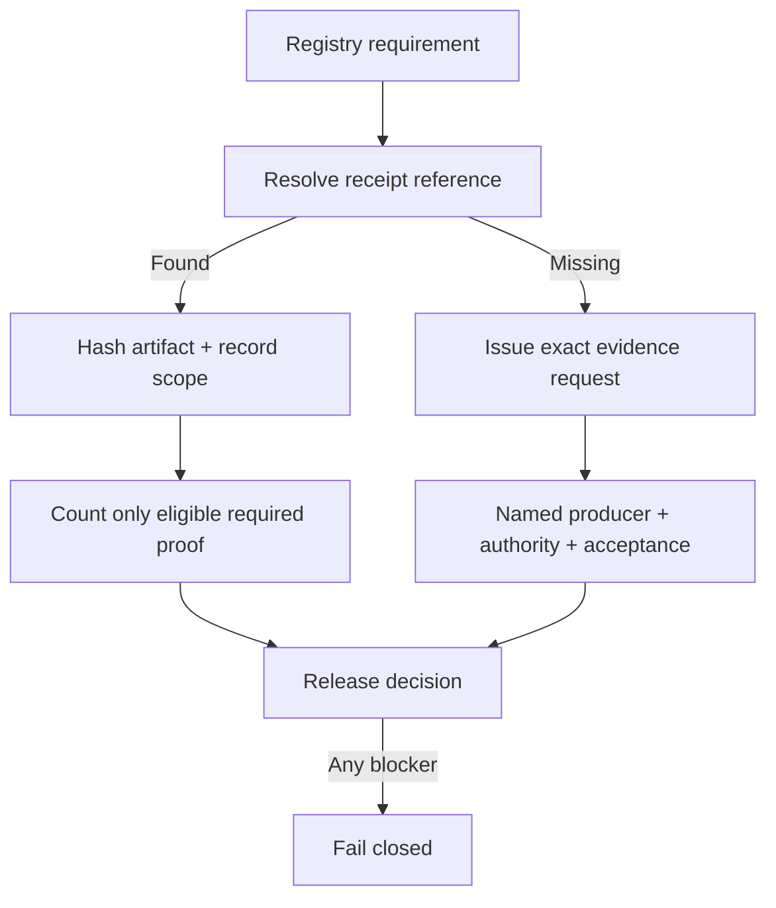
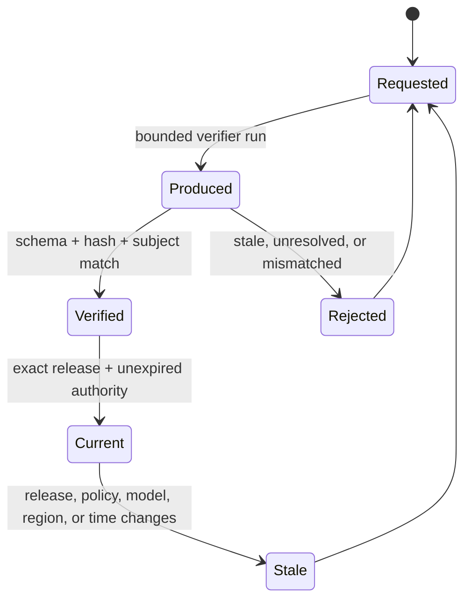

# AIGC Evidence Program V1

This program answers a narrow question: **what proof exists, what proof is missing, and exactly what must produce the missing proof?** It does not turn a plan, configuration flag, credential, or user prompt into authority.

## Current evidence position

| Measure | Result | Meaning |
|---|---:|---|
| Registry gates catalogued | 88 | Every subsystem, surface, connector certification dimension, authority flag, and release prerequisite is represented. |
| Required checks in the release denominator | 34 | The existing readiness formula remains unchanged. |
| Receipt-resolved required checks | 12 | The evidence ledger can resolve each counted receipt reference to a repository artifact. |
| Required evidence requests | 24 | 22 missing counted checks plus 2 release prerequisites. |
| Optional/deferred gates | 52 | iOS, Android, Gemini client, blockchain, Revenue-Ω, payments, marketplace, and other non-V1 paths remain visible without inflating V1 readiness. |
| Production ready | No | Exact-head CI, deployment, host, provider, recovery, and production-authority proof do not exist. |

The readiness value therefore remains **12/34 = 0.352941**. The program deliberately creates evidence requests, not fictional receipts.

## Evidence classes

| Class | What it proves | What it cannot prove |
|---|---|---|
| Local contract receipt | Schemas, deterministic behavior, fail-closed rules, zero-egress simulations | Cloud identity, public reachability, store approval, live provider behavior, production recovery |
| Exact-head CI receipt | Required checks ran after checkout on one immutable candidate commit | Deployment health, provider identity, or production authority |
| External integration receipt | A named provider/host/device accepted an exact release under a bounded identity and scope | Broad or perpetual permission; unrelated models, regions, accounts, or releases |
| Authority artifact | An authenticated owner granted a bounded action, spend, subject, and expiry | Technical success or completed execution |
| Execution receipt | A permitted action produced an observed result and reconciliation record | Authority for another action or proof of business outcome |

## Proven local evidence

- Five subsystem contract bundles resolve to `SUBSYS-746DA22A9BE241EED68DB1AA` and remain explicitly scoped to local contracts.
- MCP initialize and tool discovery now resolve to the V2 local Streamable HTTP receipt. It exercises initialize, lists all **12** current tools, calls the employer sandbox, verifies read-only closed-world annotations, and records source-file hashes.
- The read-only employer workflow resolves to `SBX-4F88AB73D87044790709ABBF` with zero provider calls, zero credential access, and zero external actions.
- OpenAI and Vertex terms/scope checks resolve to the engineering policy review `TERMS-REVIEW-20260814-OAI-GCP`; legal approval and provider identity remain false.

The older six-tool MCP receipt is retained as historical evidence but is no longer used by the readiness registry.

## Required proof still missing

| Trust boundary | Missing counted checks | Evidence producer |
|---|---:|---|
| Exact candidate / Linux release | 4 | GitHub Actions, artifact registry, deployment verifier, security/load/recovery harness |
| Web origin | 5 | Hosting platform plus accessibility, browser, header, telemetry, and alert probes |
| ChatGPT host | 2 | Confirmed-write sandbox adapter and ChatGPT connector validation |
| OpenAI connector | 4 | Bound provider identity, exact model/scope canary, failure/recovery test, immutable live receipt |
| Vertex connector | 4 | Bound GCP identity/project/region/model, canary, recovery test, immutable live receipt |
| Required authorities | 3 | Authenticated cloud, public-traffic, and production-activation owners |

## Receipt lifecycle

## Required execution order

1. **Unblock exact-head CI.** Fix the GitHub Actions billing/spending condition, rerun required jobs on the final candidate SHA, and retain job/run/artifact identifiers.
2. **Bind immutable release artifacts.** Build, scan, sign, and record the Linux image digest, SBOM, and provenance.
3. **Validate non-production deployments.** Exercise authenticated health, load, security, rollback, browser, accessibility, headers, telemetry, and alerting.
4. **Certify hosts and providers.** Bind identities and scopes, run one-use canaries, prove indeterminate-outcome recovery, then issue host/provider receipts.
5. **Collect separate authority.** Only authenticated, bounded cloud/public/production grants can clear the final three counted gates.
6. **Reconcile before promotion.** All receipts must match the same exact release. Then—and only then—set release evidence current and remove template-only status in a reviewed release change.

## Machine-readable artifacts

- `reports/artifacts/aigc_evidence_program_local_validation.json` — canonical 88-gate ledger with artifact hashes and status.
- `reports/evidence_requests/aigc_external_evidence_requests.v1.json` — one deterministic request packet for every unresolved required or optional gate.
- `schemas/aigc_evidence_program.schema.json` and `schemas/aigc_evidence_request_bundle.schema.json` — validation contracts.
- `scripts/build_aigc_evidence_program.py --check` — stale-artifact detector.
- `scripts/validate_aigc_mcp_loopback_v2.py --check` — reproducible local MCP receipt verifier.

## Safety statement

No evidence artifact in this program grants authority, contacts a provider, spends money, deploys a service, publishes a URL, submits to a store, signs a contract, moves funds, contacts an investor, or touches a blockchain mainnet. Missing trust-boundary evidence remains visibly blocked.
