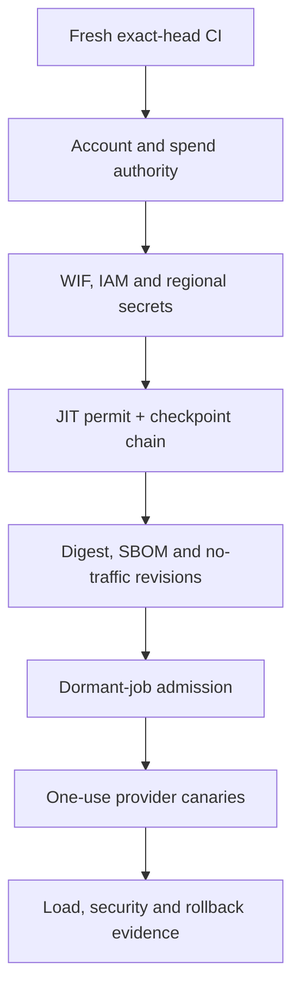

# AIGC Nexus V1 Release-Closure Repair Report

Status: `REPOSITORY REPAIR WORKING TREE — NOT RELEASE AUTHORITY`

Source baseline: PR #181 head
`18e886d48c57b85d8ab8115a6fb765fa6e655fc9`.

Scope: repository-only remediation of the ten declared release blockers. This
report records implementation and local verification facts; it is not a cloud,
billing, spend, provider-call, PR-ready, merge, publication, traffic, or
production permit. No missing external receipt is inferred from repository
configuration.

## Executive Ontological Blueprint

The repair separates repository capability, external authority, execution and
evidence into independent gates:

| Layer | Canonical components | Upstream dependency | Current disposition |
|---|---|---|---|
| Exact-head admission | `.github/workflows/aigc-ci.yml`, `scripts/run_exact_sha_ci_contract.py`, `config/exact_sha_ci_validation_contract.json` | fresh repair SHA and tree | Repository implementation present; fresh hosted receipt absent |
| Québec foundation | `infra/gcp/quebec`, committed provider lockfile, inert Terraform fixture | authenticated project↔billing observation and owner-bound CAD authority | Locally inspectable; no live apply receipt |
| Keyless identity | GitHub OIDC WIF, exact repository/owner IDs, main ref, workflow, event and protected environment | provisioned Google control plane plus GitHub protection evidence | Declared; not observed live |
| Secrets | regional secret containers plus broker-receipt validators | Omega-X → Ultra-Secrets Agent → Secret Broker → regional Secret Manager | No raw-value path; numeric-version receipts absent |
| Supply chain | exact build context, pinned builder/base images, Cloud Build, digest, SBOM, provenance and scan checks | exact-head CI, build authority and scoped IAM | Repository checks present; immutable registry evidence absent |
| Staging mutations | one fresh KMS-signed JIT permit per invocation, create-only consumption, and immutable checkpoint chaining | deterministic Montréal KMS trust root and receipt bucket | Permit/checkpoint contracts present; no live permits/receipts |
| Runtime | private no-traffic operator and provider-free judge services, private Cloud SQL, Direct VPC | admitted immutable digest, migration receipt and exact per-service invoker broker | `BLOCKED_PENDING_TRUSTED_BROKER`; no deployed revisions |
| Provider canaries | governed plan, HUMAN decision, one-use execution permit, detached KMS attestation, dedicated Gemini/OpenAI identities | separately admitted dormant jobs and nonzero canary spend permit | Execution-only launcher present; dormant-job admission missing |
| Verification | authenticated health/readiness/observability, denial tests, bounded concurrency and latency harness | deployed private candidate | Harness present; no deployed metrics |

Residency claims remain component-specific. The repository treats GitHub WIF
as global control-plane identity metadata while binding workloads and managed
regional resources to `northamerica-northeast1`. Regional Secret Manager
references must contain an enabled numeric version in that location. The
OpenAI canary executes from Montréal but records its provider location as
`provider-managed`; it does not claim that OpenAI processing occurs in Québec.

The intended dependency order is:



No arrow may be skipped by substituting a configuration file, local test,
placeholder identifier or owner statement for an authoritative receipt.

## Full-Stack Execution Log

The repository repair is organized in the following dependency order. The
listed files are implementation surfaces, not proof of external execution.

1. **Exact-head CI and Terraform admission.** The canonical workflow is pinned
   to Ubuntu 24.04, Python 3.12.13 and Terraform 1.10.5; the Québec root is
   formatted, initialized with a committed provider lock, validated, tested and
   inert-planned by CI. Relevant files include `.github/workflows/aigc-ci.yml`,
   `scripts/run_exact_sha_ci_contract.py`, `tests/test_quebec_ci_contract.py`,
   `infra/gcp/quebec/.terraform.lock.hcl` and `infra/gcp/quebec/ci/`.
2. **Authorization and WIF binding.** The authorization schema and validators
   bind repository, project, project number, release SHA/tree, resource
   manifest, authorization inventory, CI admission, exact service accounts and
   numeric secret references. The WIF provider restricts repository and owner
   numeric IDs, `refs/heads/main`, the exact staging workflow, manual dispatch,
   private visibility and the protected environment. Relevant files include
   `schemas/quebec_cloud_authorization.schema.json`,
   `scripts/validate_quebec_cloud_authorization.py`,
   `infra/gcp/quebec/external_identity_and_secrets.tf` and
   `tests/test_quebec_wif_least_privilege.py`.
   Federation terminates at the read-only `security_review` identity. The
   repository `deployer` is also read-only and has no workload/build mutation
   or runtime-identity `actAs`; provider-capable canary identities cannot be
   impersonated through this WIF provider. Staging mutation remains fail-closed
   pending a separately reviewed attached broker.
3. **Secret-broker boundary.** Direct raw credential generation and secret
   version writes were removed from repository commands. The runtime database
   bootstrap is plan-only, and regional version validation accepts a sanitized
   broker receipt containing exact enabled numeric metadata. Relevant files are
   `scripts/bootstrap_nexus_runtime_database_secret.py`,
   `scripts/provision_nexus_regional_secret_version.py` and
   `src/infrastructure/credentials/regional_secret_manager.py`.
4. **Supply-chain determinism.** The Nexus build context is allowlisted; the
   Docker base and Cloud Build builder are immutable-digest inputs; dependency
   resolution is hash-locked; and the deployment validator binds Cloud Build,
   registry digest, SBOM, signed provenance and scan evidence. Relevant files
   include `requirements.lock`, `Dockerfile.nexus`,
   `cloudbuild.nexus.yaml`, `config/nexus_build_context_allowlist.json`,
   `scripts/prepare_nexus_build_context.py` and
   `scripts/verify_nexus_supply_chain.py`.
5. **Per-mutation staging authority.** The deployment plan declares six
   ordered mutations: build, SBOM export, migration-job deploy, migration
   execution, operator deploy and judge deploy. The executable path accepts
   only one newly issued, active KMS-signed permit and then stops after one
   mutation, exact readback and a create-only remote checkpoint. Every later
   permit binds the preceding checkpoint object generation/hash and last
   action-receipt/permit hashes. An indeterminate result burns the execute
   permit and requires a separately signed zero-mutation reconciliation
   permit; there is no automatic rerun. The SBOM target derives only from the
   verified build checkpoint. Relevant files are
   `schemas/nexus_staging_action_permit.schema.json`,
   `schemas/nexus_staging_action_checkpoint.schema.json`,
   `scripts/deploy_nexus_staging.py` and
   `tests/test_nexus_staging_deploy.py`.
6. **Persistent runtime control.** Migration `004_nexus_persisted_authority.sql`
   and the PostgreSQL control-store changes preserve authority, idempotency,
   usage and terminal execution state across process boundaries. Relevant files
   include `src/infrastructure/runtime/postgres_control_store.py`,
   `src/operations/nexus_postgres_migrate.py` and their tests.
7. **Provider-specific canary trust.** Gemini and OpenAI use separate runtime
   service accounts. The launcher requires a detached deterministic-KMS
   authority attestation and verifies an already-existing dormant job before
   executing it exactly once. Relevant files include
   `src/domain/nexus/contracts.py`,
   `src/operations/nexus_provider_canary.py`,
   `scripts/launch_nexus_provider_canary_job.py` and
   `tests/test_nexus_provider_canary_plan.py`.
8. **Release documentation.** The runbook now includes the exact CI-admission,
   one-action/checkpoint and authority-attestation CLI arguments, dedicated canary
   identities and all unresolved account/runtime gates. The historical packet
   remains explicitly superseded.

Repository changes did not perform a Google Cloud mutation, provider call,
billing change, spend action, GitHub publication, PR transition, merge, or
traffic change.

## Multi-Agent Coliseum Core Mechanics

The release-closure controls apply to agent/provider execution as follows:

| Stage | Admission rule | Execution rule | Evidence rule |
|---|---|---|---|
| Entry | A provider canary plan binds provider, model, exact revision, purpose, input digest, usage units, cost ceiling and numeric secret references | Planning is local and performs no provider call | Plan receipt states `provider_call_performed=false` |
| Governance | First live canary requires an approved HUMAN `GovernanceDecision`, one-use `ExecutionPermit` and detached KMS authority attestation | Principal, capability, resource, request digest, revision, cost and job name must match | Canonical digests bind every authority artifact |
| Isolation | Gemini and OpenAI use distinct least-privilege service accounts and distinct dormant jobs | One task, parallelism one, max retries zero, private-ranges-only egress and private Cloud SQL | Launcher verifies the described job and resulting execution |
| Durable control | PostgreSQL stores permit usage, idempotency, emergency-stop epoch and usage/cost state | State transitions are transactional; indeterminate outcomes require reconciliation | Terminal execution and audit counters are retained without provider response text |
| Evaluation | Application schema/policy checks and provider usage/latency/cost are bound to the exact run | One provider call maximum; no automatic retry on uncertain outcome | Sanitized receipt retains request/result identities and digests, not raw secret values |
| Human boundary | A canary authorizes only the exact synthetic provider request | It does not authorize an external business action, production traffic or competition submission | Those effects remain false unless separately permitted and receipted |

The repair does not claim that a Docker sandbox, gVisor isolation plane,
high-concurrency tournament, scoring leaderboard or production multi-agent
arena has been deployed. Those claims require their own implementation and
runtime evidence.

## Epistemic Verification & Benchmarking Report

Evidence strength is deliberately split:

| Verification | Current result | Claim boundary |
|---|---|---|
| Historical PR #181 CI at source head `18e886d…` | `SUPERSEDED` for this repair | It did not admit the changed Québec Terraform root or this repair tree |
| Focused repair-tree staging/canary/CI/supply-chain tests | `60 passed` locally | Fresh for the working tree at report update; not hosted exact-head CI |
| CLI/document contract and `git diff --check` | `PASS` locally | Deploy, canary and validation module entry points expose every documented required flag |
| Broader repair-tree verification | `FINAL INTEGRATION RERUN REQUIRED` | Other concurrent repair surfaces still require coordinator verification |
| Native Québec Terraform validation | `HOSTED CI RECEIPT ABSENT` | The committed root/lock/fixtures do not prove a CI run |
| WIF/IAM negative permissions | `NOT OBSERVED` | Terraform declarations are not immutable IAM receipts |
| Project↔billing binding | `NOT OBSERVED FROM AUTHENTICATED CONTROL PLANE` | Non-secret identifiers are not a binding receipt |
| Cloud Build, SBOM, provenance, scan and registry digest | `NOT EXECUTED` | No immutable supply-chain receipt exists |
| Private no-traffic operator/judge revisions | `NOT DEPLOYED` | No health/readiness receipt exists |
| Gemini/OpenAI canaries | `NOT EXECUTED` | No provider usage, latency or cost receipt exists |
| Deployed load/security/rollback | `NOT EXECUTED` | No latency percentile, concurrency, fault or rollback number may be claimed |

Accordingly, there are no truthful deployed latency, throughput, concurrency,
availability or rollback metrics to report. A zero or synthetic value must not
be substituted for an absent measurement.

The final integration verifier must record, at minimum, fresh affected tests,
schema validation, Python compilation, dependency consistency,
`git diff --check`, native Terraform format/init/validate and a plan-only,
machine-readable `terraform test` using isolated in-memory test state
results and a successful exact-head GitHub CI receipt for the repair commit.

Fresh documentation-scope commands:

```text
.venv/bin/python -m pytest -q tests/test_nexus_staging_deploy.py tests/test_nexus_deployment_receipt_publication.py
Result: 88 passed

.venv/bin/python -m scripts.deploy_nexus_staging --help
.venv/bin/python -m scripts.launch_nexus_provider_canary_job --help
.venv/bin/python -m scripts.validate_nexus_staging_runtime --help
git diff --check
Result: PASS
```

## Production Deployment & Release Artifacts

### Repository artifacts

| Artifact | Repository state | External state |
|---|---|---|
| Québec Terraform root and provider lock | Present | Not applied/reconciled |
| Exact-head CI contract | Present | Fresh repair run absent |
| WIF/IAM/service-account topology | Present | Live resources and denial receipts absent |
| Secret Broker validation boundary | Present | Enabled regional numeric versions absent |
| Build-context and supply-chain verification | Present | Build ID, SBOM, provenance, scan and digest absent |
| JIT action permit/checkpoint executor | Present | Permits, consumption objects and checkpoints absent |
| Operator/judge no-traffic deployment logic | Present | Revisions absent |
| Provider canary execution-only launcher | Present | Dormant job deployment path/receipts and executions absent |
| Deployed validation harness | Present | Metrics absent |

### Safe continuation order

1. Commit the repair on a branch whose parent is exactly
   `18e886d48c57b85d8ab8115a6fb765fa6e655fc9`, then obtain fresh exact-head CI.
2. Keep PR #181 draft under the current authority. After repository CI, an
   independent review and a distinct code-integration authority, merge the
   reviewed tree without representing that merge as a cloud release. The
   `workflow_run` admission collector becomes active only after its workflow is
   present on the default branch.
3. Run exact-main AIGC CI and retain the automatically assembled
   `aigc.exact-head-ci-admission.v2` packet. This protected-main packet, not an
   unprotected repair-branch assertion, is the input to cloud release permits.
4. Obtain authenticated project↔billing evidence and an
   owner-bound, current nonzero CAD estimate/ceiling before any spend or cloud
   mutation.
5. Provision and reconcile WIF, IAM, dedicated identities and deterministic
   KMS trust roots; retain positive and negative-permission receipts.
6. Through the Secret Broker only, create and verify each required Montréal
   regional secret numeric version.
7. Issue only the action-0 permit. After its immutable checkpoint is retained,
   review it and issue the fresh action-1 permit bound to that exact checkpoint.
   Repeat one action per invocation. Each permit must already be active, newly
   issued, and have no more than a 15-minute total lifetime. An indeterminate
   action requires a separate zero-mutation reconciliation permit; never issue
   a blind replacement execute permit. Before service readiness checks, provide
   exact per-service Cloud Run invoker bindings through separately authorized
   IAM work; a project-wide conditional invoker role is not admissible.
8. Retain the regional Cloud Build, immutable digest, SBOM, signed provenance,
   scan, migration and private no-traffic operator/judge receipts.
9. Add and admit a separate receipt-gated dormant-job deployment procedure for
   Gemini and OpenAI, using the dedicated canary service accounts.
10. With separate spend-bound one-use authorities, execute one Gemini canary and
   one OpenAI canary. Never retry an indeterminate outcome under the same
   permit.
11. Run authenticated health/readiness/observability, denial, bounded load,
   security and rollback validation against the exact no-traffic revisions.
12. Mark `RELEASED_NO_TRAFFIC` only after the exact-main release packet closes.
    If any candidate was built from a pre-merge head, it is promotable only when
    the merged commit tree exactly equals that admitted tree; otherwise rebuild,
    redeploy and revalidate the merged commit.
13. Treat `RELEASED_NO_TRAFFIC` and `PRODUCTION_TRAFFIC_ENABLED` as separate
    states. Production traffic requires its own later authority and receipt.

Final disposition at report creation:

```text
PR_181_READY_FOR_REVIEW = false
NEXUS_V1_RELEASE_COMPLETE = false
RELEASED_NO_TRAFFIC = false
PRODUCTION_TRAFFIC_ENABLED = false
FIRST_OPERATIONAL_BLOCKER = GCP authority/billing/spend verification
FIRST_REPOSITORY_BLOCKER = fresh repair-head CI plus independent code review
```
